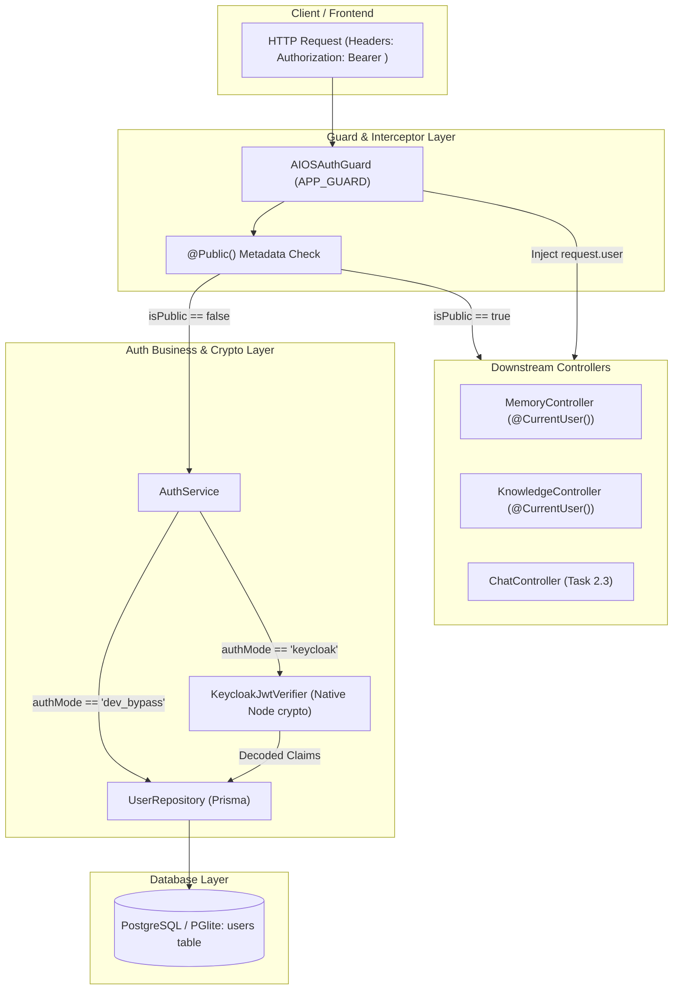
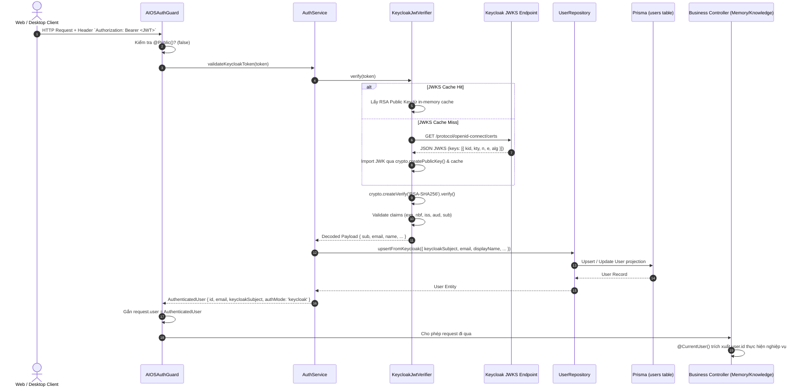
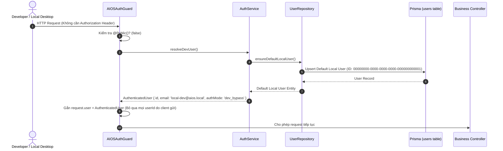

# Auth Module — Tài liệu Kỹ thuật (Technical Document)

## 1. Mục tiêu Kỹ thuật

Module **Auth** cung cấp tầng bảo vệ tập trung (Centralized Security Layer) cho toàn bộ backend của AIOS theo nguyên tắc **Clean Architecture** và **Zero-Trust**:

- Cung cấp cổng xác thực toàn cục (`AIOSAuthGuard` qua `APP_GUARD`) hỗ trợ chuyển đổi linh hoạt giữa chế độ `keycloak` và `dev_bypass` qua biến môi trường `AUTH_MODE`.
- Thực hiện xác thực chữ ký mật mã (Cryptographic Verification) cho Keycloak OIDC Access Token dựa trên chuẩn JWKS mà **không phụ thuộc vào thư viện ngoài nặng nề**, sử dụng thư viện mật mã tiêu chuẩn `node:crypto`.
- Quản lý vòng đời dữ liệu của người dùng (`User` model trong Prisma) và cung cấp decorator `@CurrentUser()` cho các Controller trong toàn bộ hệ thống.
- Bảo đảm tính cô lập dữ liệu (Multi-tenant Data Isolation) và lọc mềm (`deletedAt: null`) ngay khi truy vấn tại các Repository của `MemoryModule` và `KnowledgeModule`.

---

## 2. Kiến trúc Tổng thể & Thành phần Hệ thống



---

## 3. Luồng Xử lý Dữ liệu (Sequence Diagrams)

### 3.1. Luồng Xác thực OIDC Bearer Token (`AUTH_MODE=keycloak`)



### 3.2. Luồng Local Development Bypass (`AUTH_MODE=dev_bypass`)



---

## 4. Chi tiết Kỹ thuật Các Thành phần Cốt lõi

### 4.1. `KeycloakJwtVerifier` (`keycloak-jwt-verifier.service.ts`)
- **Native Cryptographic Engine:** Không sử dụng các thư viện cồng kềnh hoặc phụ thuộc mạng, lớp này dùng trực tiếp `node:crypto`:
  - `crypto.createPublicKey({ key: jwk, format: 'jwk' })` để import public key từ JWKS.
  - `crypto.createVerify(ALG_MAP[header.alg])` để xác thực tính toàn vẹn của chữ ký số đối với chuỗi `${headerB64}.${payloadB64}`.
- **Ánh xạ thuật toán chữ ký:**
  - `RS256` -> `RSA-SHA256`
  - `RS384` -> `RSA-SHA384`
  - `RS512` -> `RSA-SHA512`
  - `ES256` -> `sha256`
  - `ES384` -> `sha384`
  - `ES512` -> `sha512`
- **JWKS In-memory Caching:**
  - Cache các `KeyObject` theo `kid` với TTL 1 giờ.
  - Khi gặp `kid` lạ chưa có trong cache, tự động kích hoạt `refreshJwks()` để nạp key mới xoay vòng từ Keycloak server.
- **Tiêu chuẩn kiểm tra (Validation Rules):**
  1. Định dạng: JWT bắt buộc có đúng 3 phần phân tách bằng dấu chấm `.`.
  2. Thời gian: `exp > now` (chưa hết hạn) và `nbf <= now` (đã có hiệu lực).
  3. Định danh: `iss` phải khớp `KEYCLOAK_URL/realms/KEYCLOAK_REALM`.
  4. Client Audience: `aud` phải chứa `KEYCLOAK_CLIENT_ID` nếu biến môi trường này được cấu hình.
  5. Chủ thể: Bắt buộc phải có claim `sub`.

### 4.2. `AIOSAuthGuard` (`guards/aios-auth.guard.ts`)
- Cài đặt giao diện `CanActivate` của NestJS.
- Đăng ký toàn cục dưới token `APP_GUARD` trong `AuthModule`, tự động bảo vệ 100% các route trong hệ thống.
- Sử dụng `Reflector` để đọc metadata `@Public()`.
- Nhánh rẽ phân quyền:
  - Nếu `authMode === 'dev_bypass'`: Gọi `authService.resolveDevUser()`, gán vào `request.user` và return `true`.
  - Nếu `authMode === 'keycloak'`: Bắt buộc kiểm tra header `Authorization: Bearer <token>`. Nếu thiếu hoặc sai format -> ném `UnauthorizedException`.

### 4.3. Decorators (`decorators/`)
- **`@CurrentUser()` (`current-user.decorator.ts`):**
  - Trích xuất thông tin người dùng từ `request.user`.
  - Hỗ trợ cú pháp linh hoạt:
    ```typescript
    @Get('me')
    getMe(@CurrentUser() user: AuthenticatedUser) { ... }

    @Get('id')
    getId(@CurrentUser('id') userId: string) { ... }
    ```
- **`@Public()` (`public.decorator.ts`):**
  - Gắn metadata `isPublic: true` lên controller handler hoặc controller class để bỏ qua bước kiểm tra Bearer token.

### 4.4. `UserRepository` (`user.repository.ts`)
- Thực hiện các thao tác persistence với bảng `users` qua `PrismaService`.
- Phương thức `upsertFromKeycloak`:
  - Tìm theo `keycloakSubject`. Nếu thấy -> cập nhật profile.
  - Nếu không thấy theo subject, tìm theo `email`. Nếu tìm thấy tài khoản cũ có `keycloakSubject === null` -> liên kết subject (account linking).
  - Nếu không thấy -> tạo mới user với UUIDv4 sinh tự động.
- Phương thức `ensureDefaultLocalUser`:
  - Đảm bảo bản ghi với ID cố định `00000000-0000-0000-0000-000000000001` tồn tại trong database để tránh vi phạm khóa ngoại ở các module khác khi chạy local.

---

## 5. Danh tả API (REST API Specifications)

### 5.1. `GET /auth/me`
Lấy thông tin profile người dùng đang đăng nhập và chế độ xác thực hiện hành.

- **Headers:**
  - `Authorization: Bearer <token>` (khi `AUTH_MODE=keycloak`)
- **Responses:**
  - `200 OK`:
    ```json
    {
      "user": {
        "id": "123e4567-e89b-12d3-a456-426614174000",
        "email": "user@aios.local",
        "displayName": "Hoang Thao",
        "keycloakSubject": "f81d4fae-7dec-11d0-a765-00a0c91e6bf6",
        "emailVerified": true,
        "createdAt": "2026-11-19T10:00:00.000Z",
        "updatedAt": "2026-11-19T10:00:00.000Z"
      },
      "authMode": "keycloak"
    }
    ```
  - `401 Unauthorized`: Token thiếu, hết hạn, hoặc chữ ký không hợp lệ.
  - `404 Not Found`: Không tìm thấy bản ghi người dùng tương ứng trong database.

### 5.2. `POST /auth/logout`
Hủy bỏ phiên làm việc cục bộ của người dùng.

- **Headers:**
  - `Authorization: Bearer <token>` (khi `AUTH_MODE=keycloak`)
- **Responses:**
  - `200 OK`:
    ```json
    {
      "success": true,
      "message": "Đăng xuất thành công."
    }
    ```

---

## 6. Tích hợp và Bảo vệ `MemoryModule` & `KnowledgeModule`

Sau khi hoàn thiện `AuthModule`, hai module nghiệp vụ đã được cập nhật toàn diện:

1. **`MemoryController` & `KnowledgeController`:**
   - Mọi route nhận diện người dùng qua `@CurrentUser() user?: AuthenticatedUser`.
   - `user?.id` được truyền xuống tầng Service và Repository.
2. **`MemoryRepository` & `KnowledgeRepository`:**
   - Mọi câu lệnh truy vấn danh sách (`findManyAndCount`), tìm kiếm tương đồng (`searchSimilarity`), truy hồi liên quan (`findRecallCandidates`), và tìm theo ID/Key đều tự động lọc điều kiện:
     ```typescript
     where.deletedAt = null;
     if (userId) where.userId = userId;
     ```
   - Xóa bản ghi (`deleteById`, `deleteDocument`) áp dụng cơ chế **Soft Delete (Tombstone)** bằng cách cập nhật `deletedAt = new Date()`.

---

## 7. Chiến lược Kiểm thử (Testing Strategy)

Toàn bộ `AuthModule` và các module tích hợp được bao phủ 100% qua bộ unit tests:

| Test Suite | File Kiểm thử | Trọng tâm kiểm thử |
| :--- | :--- | :--- |
| **User Repo** | `user.repository.spec.ts` | CRUD, upsertFromKeycloak (update, link, create), ensureDefaultLocalUser. |
| **JWT Verifier**| `keycloak-jwt-verifier.service.spec.ts`| Chữ ký RSA-SHA256 hợp lệ, token hết hạn, nbf tương lai, sai issuer, sai audience, sai chữ ký, format lỗi. |
| **Auth Service** | `auth.service.spec.ts` | `getAuthMode`, `resolveDevUser`, `validateKeycloakToken`, `getMe`, `logout`. |
| **Auth Guard** | `aios-auth.guard.spec.ts` | Bỏ qua khi có `@Public()`, chế độ `dev_bypass`, chế độ `keycloak` (thiếu header, sai bearer format, token rỗng, token hợp lệ). |
| **Auth Controller**| `auth.controller.spec.ts` | Gọi hàm service tương ứng cho `/auth/me` và `/auth/logout`. |
| **Tích hợp Memory**| `memory.repository.spec.ts`, `memory.controller.spec.ts` | Truyền `userId`, compound key, kiểm tra `deletedAt: null`. |
| **Tích hợp Knowledge**| `knowledge.repository.spec.ts`, `knowledge.controller.spec.ts` | Truyền `userId`, lọc soft-delete trong semantic search và document listing. |
| **Hệ thống** | `app.module.spec.ts` | Kiểm tra khả năng biên dịch toàn bộ DI Container khi có AuthModule và APP_GUARD. |
