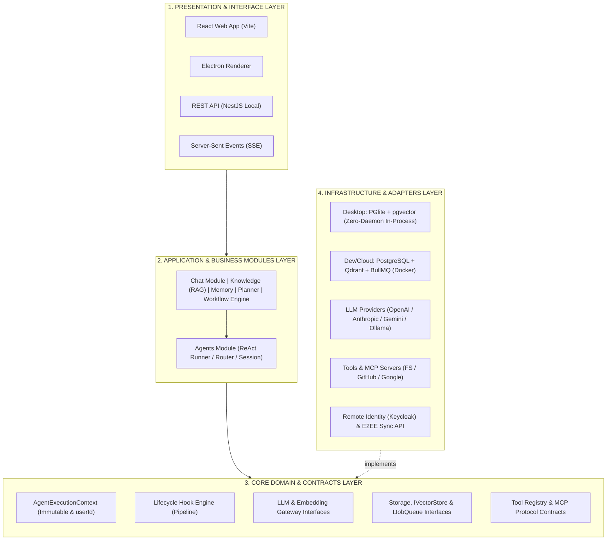
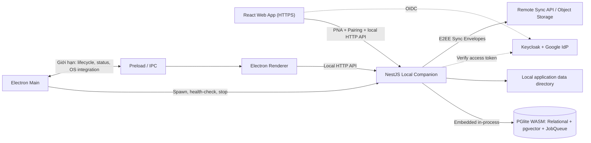
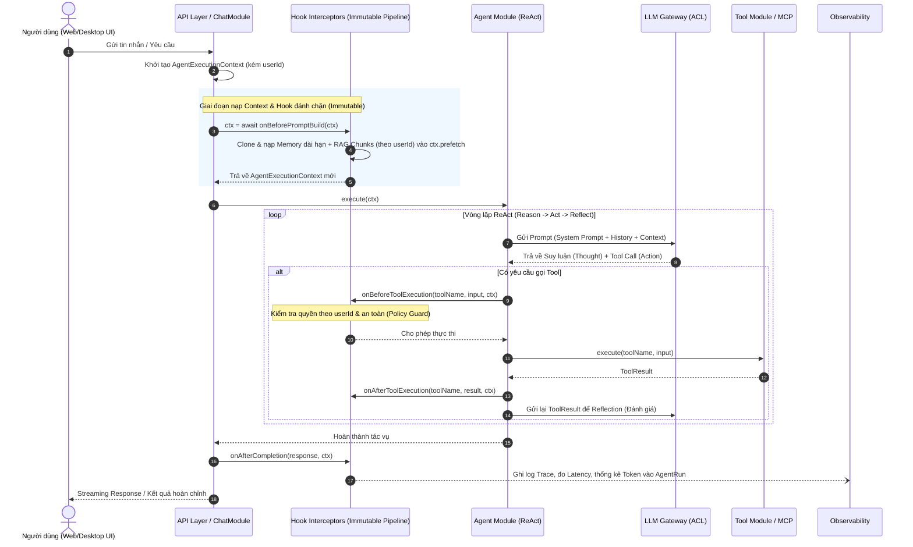

# AIOS Architecture Specification

> **Tài liệu đặc tả kiến trúc tổng thể hệ thống AIOS (Personal AI Operating System)**  
> *Được thiết kế theo phong cách Modular Monolith & Clean Architecture, kế thừa các nguyên lý trừu tượng hóa cốt lõi, Context Pattern và Lifecycle Hooks từ hệ thống Caremate.*

---

## 1. Tầm nhìn & Triết lý Thiết kế (Design Philosophy)

### 1.1. Tầm nhìn
AIOS không phải là một chatbot thông thường, mà là một **Personal Chief of Staff** (Trợ lý điều hành cá nhân). Hệ thống đóng vai trò hạt nhân điều phối tập trung giữa:
* **Mô hình ngôn ngữ lớn (LLM):** Suy luận, lập kế hoạch, tổng hợp.
* **Hệ thống tri thức cá nhân:** Lịch làm việc (Calendar), GitHub Issues, Email, Kho tài liệu (RAG), Ghi chú, Kế hoạch (Todo/Plan).
* **Công cụ thực thi (Tools/MCP):** Tác động và tương tác với thế giới bên ngoài.

### 1.2. Triết lý Kiến trúc
Hệ thống kết hợp hài hòa hai trường phái:
1. **Sự tự chủ & linh hoạt của AI Agent (ReAct Loop, Multi-Agent):** Cho phép AI giải quyết các bài toán mở, không bị giới hạn bởi các kịch bản cứng.
2. **Sự chặt chẽ, tường minh và chuẩn mực kế thừa từ Caremate:** Đưa vào các khái niệm trừu tượng hóa chuẩn (*Core Contracts*, *Context Passing*, *Lifecycle Hooks*, *Anti-Corruption Layer*) giúp hệ thống bền vững, dễ kiểm thử và độc lập với công nghệ bên ngoài.

### 1.3. Topology Sản phẩm: Web, Desktop và Local Companion
AIOS sở hữu hai client và một local runtime dùng chung:

| Thành phần | Trách nhiệm chính | Vị trí chạy | Giao thức kết nối |
|---|---|---|---|
| **Web App** | Giao diện AIOS, đăng nhập, pairing với companion, trạng thái sync và tải desktop app | Browser (Static Web App host qua HTTPS) | HTTPS, PNA tới Local API |
| **Desktop App** | Đóng gói UI bằng Electron; Electron Main khởi chạy, giám sát và dừng NestJS sidecar | Máy người dùng | Electron Preload / IPC |
| **NestJS Local Companion** | Chạy business modules, API, ingestion/RAG, job queue và truy cập dữ liệu local | Sidecar của Desktop hoặc agent cài riêng | Chỉ bind Loopback (`127.0.0.1`) |
| **Local Data Engine (PGlite)** | **PGlite (WASM Embedded Postgres)** tích hợp sẵn extension **`pgvector`**: lưu trữ đồng nhất cả dữ liệu quan hệ, canonical chunks, vector index và local job queue | Nhúng trực tiếp trong tiến trình NestJS sidecar; lưu file trong data root của AIOS (**Zero-Daemon**) | In-Process / WASM (File I/O) |
| **Identity & Sync** | Keycloak xác thực; Sync API lưu ciphertext (Sync Envelope) để đồng bộ giữa thiết bị | Dịch vụ remote (Zero-Knowledge, không lưu plaintext) | HTTPS / E2EE |

Web app và Electron Renderer gọi cùng local HTTP API. Electron IPC chỉ dùng giữa Main và Renderer cho vòng đời sidecar, trạng thái và tích hợp OS; không dùng IPC làm tầng lưu trữ hay nhân đôi business logic. Khi web chưa kết nối được companion, vẫn có thể đăng nhập, quản lý tài khoản và tải desktop, nhưng không dùng được các tính năng dựa trên dữ liệu local.

> [!TIP]
> **Kiến trúc Zero-Daemon trên Desktop với PGlite + `pgvector`:**  
> Thay vì phải đóng gói và quản lý 3 tiến trình dịch vụ nặng nề (PostgreSQL daemon, Qdrant binary, Redis server) dễ gây xung đột port và lỗi cài đặt trên Windows/macOS, bản Desktop sử dụng **PGlite** (PostgreSQL chạy dạng WebAssembly/Embedded ngay trong Node.js thông qua `@prisma/adapter-pglite`) kết hợp với extension **`pgvector`** có sẵn bên trong PGlite và hàng đợi dựa trên bảng SQL (`IJobQueue`). Nhờ kiến trúc Clean Architecture (`IVectorStore`, `IJobQueue`), môi trường Dev/Cloud vẫn có thể dùng Docker (PostgreSQL + Qdrant + BullMQ) nếu muốn, trong khi bản Desktop chỉ cần duy nhất tiến trình NestJS sidecar.

> [!NOTE]
> **Local-at-rest không đồng nghĩa toàn bộ xử lý luôn on-device:**  
> Nếu dùng LLM hosted (OpenAI, Gemini, Anthropic), các đoạn context đã truy xuất có thể được gửi tới nhà cung cấp LLM. Sync client mã hóa dữ liệu đầu cuối (E2EE) trước khi upload; người dùng giữ recovery key để khôi phục vault trên thiết bị mới.

---

## 2. Những Điểm Sáng Kế Thừa Từ Caremate

Qua quá trình phân tích kiến trúc của Caremate, AIOS kế thừa và áp dụng 4 nguyên tắc kỹ thuật quan trọng:

| Nguyên lý Caremate | Ứng dụng cụ thể vào AIOS | Lợi ích mang lại |
|---|---|---|
| **1. Pure Core Contracts** *(Chữ ký hàm độc lập)* | Định nghĩa Interface/DTOs thuần khiết tại tầng `core/`, không phụ thuộc NestJS hay DB. | Tránh Vendor Lock-in, dễ dàng thay thế thư viện và viết Unit/Mock Test. |
| **2. CdsRequest Context** *(Context Passing)* | Khái niệm `AgentExecutionContext` (Immutable Context Object đi xuyên suốt vòng đời Agent, có `userId` tại gốc). | Đảm bảo cách ly dữ liệu (Data Isolation), chuẩn hóa chữ ký hàm, dễ trace log. |
| **3. CDS Hook LifeCycle** *(Hệ thống Event Hook)* | AIOS Lifecycle Interceptors (đánh chặn trước và sau khi gọi LLM/Tool để kiểm soát an toàn). | Policy Guard bảo vệ hệ thống, làm giàu prompt minh bạch theo dạng Functional Pipeline. |
| **4. Anti-Corruption Layer** *(Bảo vệ Core Domain)* | LLM Gateway & Queue/Vector Interfaces cô lập hoàn toàn Provider bên ngoài. | Tự do đổi nhà cung cấp AI hoặc hạ tầng lưu trữ mà không ảnh hưởng Core Domain. |

### 2.1. Pure Core & Contract-First
* **Vấn đề:** Các dự án AI thông thường hay import trực tiếp SDK (ví dụ: `import OpenAI from 'openai'`) hoặc truy cập thẳng Prisma model trong Controller/Service, dẫn đến việc khi đổi provider hoặc nâng cấp thư viện thì vỡ mã nguồn hàng loạt.
* **Giải pháp thừa hưởng:** Tầng `core/` chỉ chứa **Interface thuần TypeScript** (Pure Types). Logic nghiệp vụ của AIOS chỉ phụ thuộc vào Interface (`ILLMClient`, `IEmbeddingClient`, `IVectorStore`, `IJobQueue`), không phụ thuộc vào việc bên ngoài dùng thư viện nào.

### 2.2. Context Object Pattern (`AgentExecutionContext`)
* **Vấn đề:** Trong luồng xử lý AI, một Agent cần rất nhiều thông tin: `userId`, `conversationId`, `history`, `memoryProfile`, `documentChunks`, `allowedTools`, `traceId`. Nếu truyền lẻ tẻ qua các hàm, chữ ký hàm (function signatures) sẽ phình to và rất khó bảo trì.
* **Giải pháp thừa hưởng:** Đóng gói toàn bộ thành một đối tượng bất biến (`readonly`) tương tự như `CdsRequest` của Caremate, có `userId` ngay tại gốc để đảm bảo Data Isolation:

```typescript
// core/context/agent-context.interface.ts
export interface AgentExecutionContext {
  readonly executionId: string;       // Unique trace ID cho một phiên chạy
  readonly userId: string;            // ID người dùng sở hữu phiên chạy (Data Ownership)
  readonly sessionId: string;         // ID phiên hội thoại hoặc agent session
  readonly query: string;             // Yêu cầu gốc của người dùng
  readonly context: {
    readonly userProfile: Record<string, unknown>; // Memory dài hạn
    readonly systemRules: string[];                // Quy tắc hệ thống
    readonly activePlans?: Record<string, unknown>;// Các plan hiện tại
  };
  readonly prefetch?: {
    readonly ragChunks?: DocumentChunk[];          // Dữ liệu RAG nạp trước
    readonly recentMessages?: Message[];           // Lịch sử chat gần nhất
  };
  readonly availableTools: ToolDefinition[];       // Danh sách công cụ được phép dùng
  readonly metadata: Record<string, unknown>;      // Thông tin mở rộng
}
```

### 2.3. AIOS Lifecycle Hooks (Hệ thống Hook đánh chặn bất biến)
Tương tự như cơ chế CDS Hooks lắng nghe các sự kiện y tế (`patient-view`, `order-select`), AIOS thiết lập các điểm đánh chặn (Interceptors/Hooks) trong chu trình suy luận của Agent. Để đảm bảo tính bất biến (`Immutable`) thực sự của `AgentExecutionContext`, hook `onBeforePromptBuild` hoạt động theo mô hình Pipeline (nhận vào `ctx` cũ và trả về bản sao `ctx` mới đã được làm giàu thông qua `ContextBuilder`, không mutate ngầm):

```typescript
// core/hooks/aios-hook.interface.ts
export interface AIOSHookHandler {
  /** 
   * Được gọi trước khi LLM Gateway build prompt (bổ sung memory, filter RAG).
   * Trả về một bản sao AgentExecutionContext mới (Immutable Pipeline).
   */
  onBeforePromptBuild?(ctx: AgentExecutionContext): Promise<AgentExecutionContext>;

  /** Được gọi trước khi một Tool được kích hoạt (kiểm tra quyền, an toàn hệ thống) */
  onBeforeToolExecution?(toolName: string, input: Record<string, unknown>, ctx: AgentExecutionContext): Promise<boolean>;

  /** Được gọi sau khi Tool trả về kết quả */
  onAfterToolExecution?(toolName: string, result: unknown, ctx: AgentExecutionContext): Promise<void>;

  /** Được gọi sau khi hoàn tất (ghi log Observability, tính toán token) */
  onAfterCompletion?(response: AgentResponse, ctx: AgentExecutionContext): Promise<void>;
}
```

---

## 3. Kiến Trúc Phân Tầng Tổng Thể (Layered Architecture)

Hệ thống được tổ chức theo 4 tầng phân tách nghiêm ngặt, dòng phụ thuộc chỉ đi một chiều từ ngoài vào trong:



### 3.1. Deployment và Luồng Giao tiếp Client



NestJS sidecar là runtime dùng chung cho web và desktop. Electron Main chỉ cần quản lý duy nhất tiến trình NestJS sidecar (vì PGlite + `pgvector` chạy nhúng trực tiếp bên trong tiến trình Node.js của NestJS, lưu dữ liệu ra một thư mục trong `userData`, không cần mở port DB hay cài đặt daemon riêng); Renderer và web không truy cập filesystem hay database trực tiếp.

Local API phải chỉ bind `127.0.0.1`, hỗ trợ header **Browser Private Network Access (PNA)** (`Access-Control-Allow-Private-Network: true`) kèm fallback cho các trình duyệt chặn HTTPS-to-HTTP localhost (như Safari/Brave), và yêu cầu pairing/token có scope. CORS chỉ giới hạn origin, không thay thế xác thực; IPC handlers cũng phải allowlist command và validate input. Không expose Node integration cho renderer.

---

## 4. Cấu Trúc Monorepo Chuẩn Thực Tế (`pnpm workspace`)

```text
AIOS/
├── apps/
│   ├── api/                                  # NestJS local companion/API dùng chung
│   │   ├── src/
│   │   │   ├── main.ts                       # Khởi tạo Server, Loopback, PNA & WebSockets
│   │   │   ├── app.module.ts                 # Import toàn bộ các module
│   │   │   │
│   │   │   ├── core/                         # CORE CONTRACTS & KERNEL (Pure TS & Interfaces)
│   │   │   │   ├── context/                  # ExecutionContext (có userId), ContextBuilder
│   │   │   │   ├── hooks/                    # HookRegistry, Immutable HookHandler interfaces
│   │   │   │   ├── llm/                      # LLM & Embedding Gateway interfaces & ACL
│   │   │   │   ├── queue/                    # IJobQueue interface (độc lập BullMQ/SQL Queue)
│   │   │   │   └── observability/            # ITracer, IMetricsCollector
│   │   │   │
│   │   │   ├── modules/                      # BUSINESS MODULES
│   │   │   │   ├── chat/                     # Quản lý Chat, Message, Streaming
│   │   │   │   ├── knowledge/                # Chunking, Vector Embedding, RAG
│   │   │   │   ├── memory/                   # Quản lý Long-term Profile/Preferences
│   │   │   │   ├── planner/                  # Quản lý Plan, Task, Roadmap
│   │   │   │   ├── tools/                    # Tool Registry, Built-in Tools, MCP Client
│   │   │   │   ├── workflow/                 # Workflow Engine (DAG, Step Runner)
│   │   │   │   ├── agents/                   # ReAct Runner, Specialized Agents
│   │   │   │   └── sync/                     # E2EE Sync Engine, Manifests, Tombstones
│   │   │   │
│   │   │   └── infrastructure/               # IMPLEMENTATIONS & ADAPTERS
│   │   │       ├── database/                 # PrismaService (hỗ trợ cả PGlite & Postgres chuẩn)
│   │   │       ├── vector-store/             # PgVectorAdapter (mặc định Desktop) / QdrantAdapter
│   │   │       ├── llm-providers/            # OpenAIAdapter, GeminiAdapter, OllamaAdapter
│   │   │       └── queue/                    # PgLiteQueueAdapter (Desktop) / BullMQAdapter (Dev)
│   │   │
│   │   ├── prisma/
│   │   │   └── schema.prisma                 # Lược đồ DB (kèm pgvector, Ownership & Sync fields)
│   │   └── package.json
│   │
│   ├── web/                                  # React web app + download/pairing UI
│   │   ├── src/
│   │   │   ├── components/                   # ChatBox, MarkdownViewer, KanbanBoard
│   │   │   ├── views/                        # ChatView, KnowledgeHub, PlanDashboard
│   │   │   ├── hooks/                        # useChatStream, useAgentRun
│   │   │   └── stores/                       # Zustand stores
│   │   └── package.json
│   └── desktop/                              # Electron Main, Renderer, preload, packaging
│
├── docker/                                   # HẠ TẦNG DỊCH VỤ (Môi trường Dev truyền thống)
│   ├── docker-compose.yml                    # Dev stack: PostgreSQL, Qdrant, Redis
│   └── .env.example
│
├── packages/                                 # THƯ VIỆN DÙNG CHUNG
│   └── shared-types/                         # Contracts, Sync Envelopes & DTOs dùng chung
│
├── docs/                                     # TÀI LIỆU HỆ THỐNG
│   ├── architecture.md                       # (Tài liệu này)
│   ├── plan/                                 # Kế hoạch kiến trúc và triển khai
│   ├── module-decomposition.md
│   └── vision-and-scope-docs.md
│
├── pnpm-workspace.yaml
└── README.md
```

---

## 5. Chu Trình Thực Thi Của Agent Kết Hợp Context & Hooks

Khi một tác vụ phức tạp được kích hoạt (ví dụ: *"Hôm nay mình cần làm gì?"*):



---

## 6. Chiến Lược Lưu Trữ Dữ Liệu & Đồng Bộ (Data & Sync Architecture)

| Loại dữ liệu | Nơi lưu trữ | Cơ chế quản lý |
|---|---|---|
| **Dữ liệu quan hệ & nghiệp vụ** | **PGlite local** (hoặc Postgres Dev) | `User` projection và dữ liệu AIOS như `Conversation`, `Message`, `Plan`, `Task`, `Workflow`, `MemoryRecord`; quản lý qua Prisma (`@prisma/adapter-pglite`). Có sẵn `userId`, `version`, `contentHash`, `deletedAt` (Tombstone). |
| **Canonical chunk data** | **PGlite local** | Nội dung chunk, metadata (`embeddingModel`, `dimensions`), document relation; lưu chung trong PGlite để đảm bảo tính toàn vẹn ACID tuyệt đối giữa dữ liệu quan hệ và vector. |
| **Vector index (RAG)** | **`pgvector` trong PGlite** | Dùng trực tiếp extension `pgvector` tích hợp sẵn trong PGlite qua `PgVectorAdapter` (`vector(768)` kèm HNSW index); không cần chạy thêm tiến trình Qdrant trên máy người dùng. |
| **Hàng đợi & tác vụ nền** | `IJobQueue` (PGlite SQL Queue) | Queue ingestion/workflow lưu trạng thái trực tiếp trong bảng của PGlite ở bản Desktop (không cần cài đặt Redis). |
| **File gốc** | Filesystem local | Thư mục dữ liệu AIOS theo user profile trong OS application data directory (`app.getPath('userData')`); không ghi vào thư mục cài đặt. |
| **Identity** | Keycloak remote | OIDC, Google identity provider và email verification; AIOS không lưu mật khẩu. |
| **Encrypted sync** | Sync API + object storage remote | Lưu `EncryptedSyncItem` (Sync Envelope chứa ciphertext AES-256-GCM, IV, authTag, version, `isDeleted` tombstone); vault key/recovery key do client quản lý. |
| **Trace & Telemetry** | Local runtime/log | Không ghi nội dung nhạy cảm vào log mặc định; quy định retention riêng. |

### 6.1. Nguyên tắc Dữ liệu & Sẵn sàng Đồng bộ
* **Ownership & Sync-Ready Schema:** Local `User` được ánh xạ từ Keycloak `sub` (trong giai đoạn dev trước khi gắn Keycloak, hệ thống dùng một `defaultLocalUser` được seed sẵn). Các aggregate gốc như `Document`, `Conversation`, `Plan`, `Workflow` và `MemoryRecord` bắt buộc có `userId`, `version`, và `deletedAt` (Soft-delete phục vụ đồng bộ Tombstone giữa các máy). Mọi truy vấn và file/vector operation phải áp dụng ownership (`userId`) và lọc `deletedAt: null`.
* **Sự đồng nhất giữa Dev và Desktop Production:**
  * Trên **Desktop Production**, toàn bộ Database và Vector Store chỉ là một thư mục dữ liệu của **PGlite** (được khởi tạo với `extensions: { vector }` của `@electric-sql/pglite`). Việc backup hoặc xóa dữ liệu local đơn giản là thao tác trên thư mục này, hoàn toàn miễn nhiễm với lỗi xung đột cổng mạng (port conflict) hay tường lửa chặn tiến trình con.
  * Trong **Môi trường Dev**, lập trình viên có thể bật PGlite mode hoặc dùng Docker Compose (PostgreSQL + Qdrant + Redis) thông qua biến môi trường nhờ tầng Adapter (`PgVectorAdapter` vs `QdrantAdapter`, `PgLiteQueueAdapter` vs `BullMQAdapter`).

> [!TIP]
> **Tối ưu hóa Encrypted Sync cho Vector:**  
> Không đồng bộ cấu trúc chỉ mục HNSW của `pgvector`. Tuy nhiên, nếu chunk được tạo bởi Cloud Embedding trả phí (OpenAI/Gemini), client có thể tùy chọn nén nhị phân mảng `Float32Array` vector (768 chiều) kèm `embeddingModel` và mã hóa E2EE gửi lên Sync Server. Thiết bị thứ 2 sau khi giải mã có thể ghi thẳng mảng vector vào cột `embedding` của PGlite local mà không tốn chi phí gọi lại API Embedding. Nếu dùng Local Ollama hoặc đổi model, thiết bị mới sẽ tự rebuild vector từ canonical text.

---

## 7. Đánh Giá Điểm Mạnh So Với Thiết Kế Truyền Thống

1. **Đóng gói Desktop Siêu Gọn Nhẹ (Zero-Daemon):**  
   Nhờ sử dụng **PGlite + `pgvector`** ngay trong tiến trình NestJS, ứng dụng Desktop loại bỏ hoàn toàn việc phải cài đặt ngầm PostgreSQL Server, Qdrant binary hay Redis. Không còn nỗi lo port conflict, zombie process hay bị phần mềm diệt virus chặn trên Windows/macOS.
2. **Không bị Vendor Lock-in:**  
   Thay đổi LLM Provider, Vector Store (`PgVectorAdapter` / `QdrantAdapter`) hay Job Queue chỉ cần chuyển đổi qua biến môi trường, không chạm vào bất kỳ dòng code nghiệp vụ nào.
3. **Có điểm kiểm soát an toàn & Bất biến:**  
   Hook `onBeforePromptBuild` (Immutable) và `onBeforeToolExecution`, authorization theo owner (`userId`) ngay từ trong `AgentExecutionContext`, pairing local API và giới hạn quyền tool tạo các điểm kiểm soát rõ ràng.
4. **Sẵn sàng cho Local-First & E2EE Sync từ gốc:**  
   Việc thiết kế sẵn `userId`, `version`, `contentHash` và `deletedAt` (Tombstones) ngay trong Schema cốt lõi giúp quá trình chuyển đổi sang đa thiết bị không phải đập đi xây lại tầng Repository.
