# Bounded Context — AIOS (Domain-Driven Design)

> Phân chia hệ thống AIOS thành các **Bounded Context** độc lập theo tư duy Domain-Driven Design (DDD).  
> Mỗi context sở hữu ngôn ngữ riêng (Ubiquitous Language), ranh giới trách nhiệm rõ ràng, chuẩn hóa **Multi-user Ownership (`userId`)** và sẵn sàng cho **E2EE Sync**.

---

## 1. Context Map Diagram

```mermaid
graph TD
    subgraph AIOS ["AIOS — Personal AI Operating System"]

        subgraph IdentityCtx ["🔐 Identity & Access Context"]
            direction TB
            ID1[User Projection]
            ID2[KeycloakJwtVerifier]
            ID3[AIOSAuthGuard]
            ID4[CompanionPairingToken]
        end

        subgraph LifecycleCtx ["🪝 Lifecycle & Execution Context"]
            direction TB
            LC1[AgentExecutionContext]
            LC2[AIOSHookHandler]
            LC3[ContextBuilder]
            LC4[HookRegistry]
        end

        subgraph ConversationCtx ["💬 Conversation Context"]
            direction TB
            C1[Conversation]
            C2[Message]
            C3[StreamingSession]
        end

        subgraph KnowledgeCtx ["📚 Knowledge Context (RAG)"]
            direction TB
            K1[Document]
            K2[DocumentChunk]
            K3[EmbeddingGateway]
            K4[PgVectorIndex]
        end

        subgraph MemoryCtx ["🧠 Memory Context"]
            direction TB
            M1[MemoryRecord]
            M2[MemoryProfile]
            M3[RecallService]
        end

        subgraph PlannerCtx ["📅 Planner Context"]
            direction TB
            P1[Plan]
            P2[Task]
            P3[SubTaskTree]
        end

        subgraph ToolCtx ["🔧 Tool Context"]
            direction TB
            T1[ToolRegistry]
            T2[PolicyGuard]
            T3[MCPClient]
            T4[ToolExecution]
        end

        subgraph WorkflowCtx ["⚙️ Workflow Context"]
            direction TB
            W1[Workflow]
            W2[WorkflowStep]
            W3[WorkflowEngine]
        end

        subgraph AgentCtx ["🤖 Agent Context"]
            direction TB
            A1[AgentConfig]
            A2[AgentSession]
            A3[AgentRun]
            A4[ReActRunner]
        end

        subgraph SyncCtx ["🔄 E2EE Sync Context"]
            direction TB
            S1[EncryptedSyncItem]
            S2[SyncManifest]
            S3[TombstoneTracker]
            S4[SmartVectorSync]
        end

        subgraph LLMCtx ["🔮 LLM Gateway Context (ACL)"]
            direction TB
            L1[ILLMClient]
            L2[PromptBuilder]
            L3[TokenCounter]
        end

        subgraph ObservabilityCtx ["📊 Observability Context"]
            direction TB
            O1[TraceSpan]
            O2[MetricsCollector]
        end

    end

    %% Relationships
    IdentityCtx -->|"authenticates & injects userId"| ConversationCtx
    IdentityCtx -->|"authenticates & injects userId"| KnowledgeCtx
    IdentityCtx -->|"authenticates & injects userId"| MemoryCtx
    IdentityCtx -->|"authenticates & injects userId"| PlannerCtx
    IdentityCtx -->|"authenticates & injects userId"| WorkflowCtx

    ConversationCtx -->|"initializes"| LifecycleCtx
    LifecycleCtx -->|"enriches memory"| MemoryCtx
    LifecycleCtx -->|"enriches RAG"| KnowledgeCtx
    LifecycleCtx -->|"passes context"| AgentCtx
    LifecycleCtx -->|"passes prompt"| LLMCtx

    AgentCtx -->|"evaluates policy"| ToolCtx
    AgentCtx -->|"sends reasoning"| LLMCtx

    WorkflowCtx -->|"executes"| ToolCtx
    WorkflowCtx -->|"delegates to"| AgentCtx

    ConversationCtx & KnowledgeCtx & MemoryCtx & PlannerCtx -->|"exports for E2EE Sync"| SyncCtx

    LLMCtx & ToolCtx & AgentCtx -->|"emits telemetry"| ObservabilityCtx
```

---

## 2. Định nghĩa từng Bounded Context

### 1. Identity & Access Context
* **Mục tiêu:** Quản lý định danh người dùng nội bộ, xác thực Bearer Token từ Keycloak OIDC, bảo vệ Local Companion bằng Browser PNA và Scoped Pairing Challenge.
* **Khái niệm cốt lõi:** `User`, `KeycloakSubject`, `AIOSAuthGuard`, `CompanionPairingToken`.
* **Ranh giới:** Cung cấp thông tin xác thực (`AuthenticatedUser`) cho toàn bộ các module nghiệp vụ khác; tuyệt đối không để các module tự suy đoán `userId`.

### 2. Lifecycle & Execution Context (Caremate Inspiration)
* **Mục tiêu:** Điều phối chu trình thực thi của AI thông qua đối tượng ngữ cảnh bất biến và chuỗi Hook đánh chặn.
* **Khái niệm cốt lõi:** `AgentExecutionContext` (bất biến, mang `userId`), `AIOSHookHandler` (Immutable Pipeline), `ContextBuilder`.

### 3. Conversation Context
* **Mục tiêu:** Quản lý vòng đời cuộc trò chuyện, lịch sử hội thoại và streaming phản hồi về Client qua Server-Sent Events (SSE).
* **Khái niệm cốt lõi:** `Conversation`, `Message`, `StreamingSession`.

### 4. Knowledge Context (RAG)
* **Mục tiêu:** Quản lý tài liệu gốc, trích xuất văn bản, chunking, sinh vector nhúng và tra cứu tương đồng ngữ nghĩa.
* **Khái niệm cốt lõi:** `Document`, `DocumentChunk`, `EmbeddingGateway`, `PgVectorIndex` (tích hợp trong PGlite).

### 5. Memory Context
* **Mục tiêu:** Quản lý trí nhớ dài hạn của từng người dùng theo cặp `(userId, key)` và danh mục (`profile`, `preference`, `fact`).
* **Khái niệm cốt lõi:** `MemoryRecord`, `MemoryProfile`, `RecallService`.

### 6. Planner Context
* **Mục tiêu:** Quản lý kế hoạch, lộ trình và phân rã công việc thành các sub-tasks có thứ bậc.
* **Khái niệm cốt lõi:** `Plan`, `Task`, `SubTaskTree`.

### 7. Tool Context
* **Mục tiêu:** Đăng ký công cụ, tích hợp Model Context Protocol (MCP) và kiểm duyệt an toàn qua Policy Guard (`onBeforeToolExecution`).
* **Khái niệm cốt lõi:** `ToolRegistry`, `PolicyGuard`, `MCPClient`, `ToolExecution`.

### 8. Workflow Context
* **Mục tiêu:** Điều phối các quy trình nhiều bước (DAG), quản lý trạng thái State Machine cho phép Pause, Resume và Cancel.
* **Khái niệm cốt lõi:** `Workflow`, `WorkflowStep`, `WorkflowEngine`.

### 9. Agent Context
* **Mục tiêu:** Quản lý vai trò (Persona) và vận hành vòng lặp suy luận ReAct (`Reason` → `Act` → `Reflect`).
* **Khái niệm cốt lõi:** `AgentConfig`, `AgentSession`, `AgentRun`, `ReActRunner`.

### 10. E2EE Sync Context
* **Mục tiêu:** Đồng bộ dữ liệu đa thiết bị bằng các gói mã hóa đầu-cuối (`EncryptedSyncItem` - AES-256-GCM), lan truyền Tombstones và hỗ trợ Smart Vector Sync (nén `Float32Array`).
* **Khái niệm cốt lõi:** `EncryptedSyncItem`, `SyncManifest`, `TombstoneTracker`, `SmartVectorSync`.

### 11. LLM Gateway Context (Anti-Corruption Layer)
* **Mục tiêu:** Cô lập hệ thống khỏi SDK các nhà cung cấp bên ngoài (OpenAI, Gemini, Anthropic, Ollama).
* **Khái niệm cốt lõi:** `ILLMClient`, `IEmbeddingClient`, `PromptBuilder`, `TokenCounter`.

### 12. Observability Context
* **Mục tiêu:** Thu thập dấu vết thực thi (Tracing), đo độ trễ và thống kê lượng token tiêu thụ.
* **Khái niệm cốt lõi:** `TraceSpan`, `MetricsCollector`.

---

## 3. Tổng hợp Context Relations & ACL

| From Context | To Context | Mối quan hệ | Mục đích |
|---|---|---|---|
| **Identity** | Mọi Business Context | **Upstream → Downstream** (U/D) | Cung cấp danh tính và quyền sở hữu (`userId`) |
| **Conversation** | **Lifecycle** | **Customer / Supplier** | Khởi tạo `AgentExecutionContext` và kích hoạt Hook |
| **Lifecycle** | **Memory / Knowledge** | **Customer / Supplier** | Làm giàu ngữ cảnh (`onBeforePromptBuild`) |
| **Agent** | **Tool** | **Customer / Supplier** | Kiểm duyệt và kích hoạt công cụ bên ngoài |
| **Agent / Conversation** | **LLM Gateway** | **Upstream → Downstream** | Gửi prompt chuẩn hóa và nhận token streaming |
| **Tất cả Business Context** | **E2EE Sync** | **Published Language** | Cung cấp dữ liệu phiên bản kèm `deletedAt` để mã hóa sync |
| **LLM / Tool / Agent** | **Observability** | **Published Language** | Ghi nhận telemetry, span và token usage |
| **LLM Gateway** | **External LLM Providers** | **Anti-Corruption Layer (ACL)** | Ngăn chặn rò rỉ SDK bên ngoài vào Core Domain |
