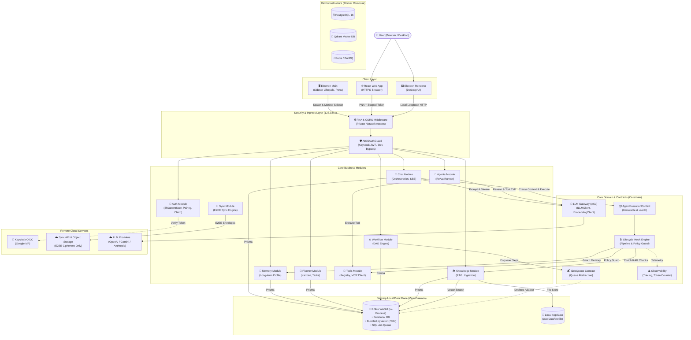
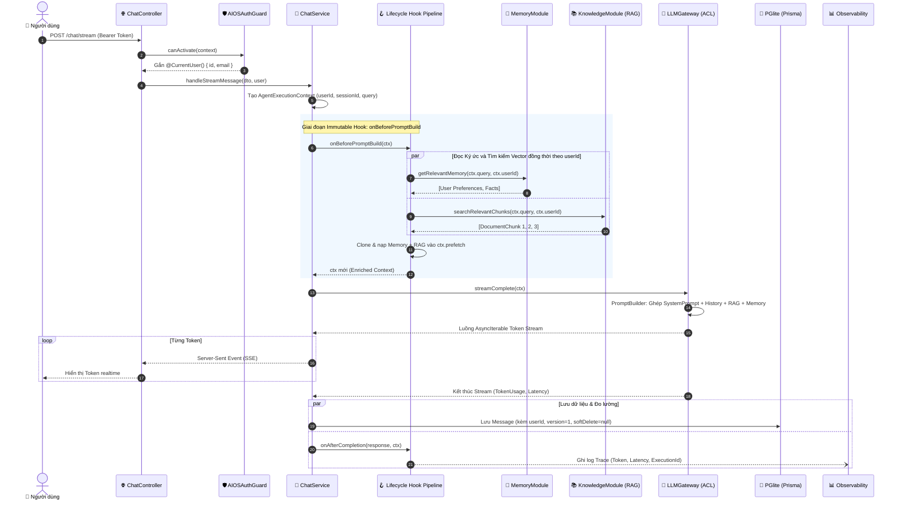
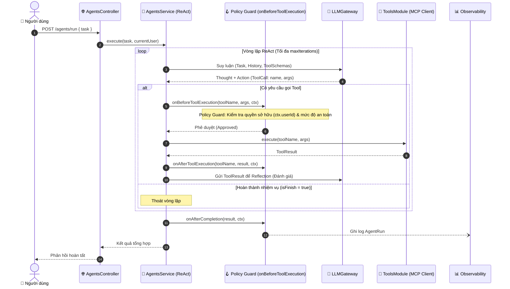
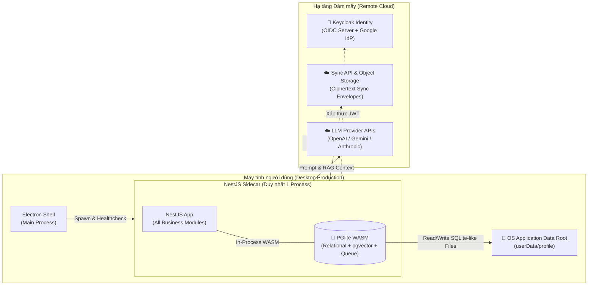

# Component Diagram — AIOS

> Mô tả chi tiết cấu trúc thành phần, luồng dữ liệu, interface và các điểm tích hợp hạ tầng trong hệ thống AIOS theo kiến trúc **Modular Monolith & Clean Architecture (Zero-Daemon trên Desktop)**.

---

## 1. High-Level Component Diagram

---

## 2. Sequence Diagram — Chat với RAG, Memory & Lifecycle Hooks

---

## 3. Sequence Diagram — Agent ReAct Loop & Policy Guard

---

## 4. Deployment View: Desktop Zero-Daemon vs Cloud

