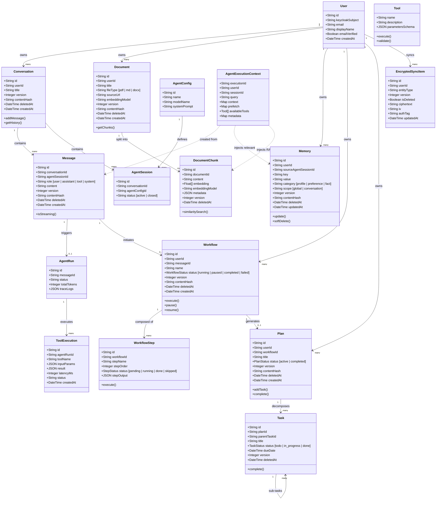

# Domain Model — AIOS

> Mô tả các thực thể cốt lõi (Entities), Value Objects và quan hệ giữa chúng trong hệ thống AIOS theo hướng **Domain-Driven Design (DDD)** và chuẩn hóa **Multi-user Ownership & E2EE Sync**.

---

## Domain Model Diagram

---

## Mô tả Entity

### Core Domain Entities

| Entity | Trách nhiệm trong Domain |
|---|---|
| `User` | Đại diện cho chủ sở hữu tài khoản, được ánh xạ từ `sub` của Keycloak OIDC. |
| `Conversation` | Tập hợp các lượt trao đổi tin nhắn, thuộc sở hữu của một `User`. |
| `Message` | Đơn vị tương tác trung tâm trong hệ thống, kích hoạt ReAct Agent hoặc Workflow. |
| `Document` | Tài liệu người dùng tải lên, có gắn `embeddingModel` phục vụ Smart Vector Sync. |
| `DocumentChunk` | Đoạn văn bản băm nhỏ kèm vector nhúng `vector(768)` lưu trong `pgvector`. |
| `Memory` | Ký ức dài hạn của người dùng, phân biệt theo `(userId, key)` và danh mục. |
| `Plan` / `Task` | Kế hoạch công việc có cấu trúc cây (sub-tasks), tự động quản lý bởi Planner. |
| `Workflow` / `Step` | Quy trình tự động hóa nhiều bước (DAG), quản lý qua State Machine. |
| `AgentConfig` / `Session` / `Run` | Ba tầng quản lý Agent: Ai (Config) → Khi nào (Session) → Làm gì (Run). |
| `ToolExecution` | Bản ghi vết thực thi công cụ bên ngoài, lưu kết quả và độ trễ. |

---

## Value Objects & DTOs

| Value Object | Mô tả |
|---|---|
| `AgentExecutionContext` | Đối tượng bất biến (`readonly`) mang `userId`, context dài hạn và RAG prefetch đi xuyên suốt chu trình xử lý của Agent. |
| `EncryptedSyncItem` | Gói dữ liệu đồng bộ mã hóa đầu-cuối (Sync Envelope chứa ciphertext AES-256-GCM, IV, authTag, tombstone). |
| `embedding: Float[]` | Vector biểu diễn ngữ nghĩa 768 chiều (tương thích `pgvector`). |
| `SmartVectorPayload` | Mảng nhị phân `Float32Array` được nén và mã hóa để đồng bộ vector giữa các máy mà không mất phí embed lại. |

---

## Data Storage Mapping

| Entity | Môi trường Desktop Production | Môi trường Dev / Docker |
|---|---|---|
| **User (Projection)** | PGlite (WASM) Local | PostgreSQL 16 |
| **Conversation, Message** | PGlite (WASM) Local | PostgreSQL 16 |
| **Document, Chunk text** | PGlite (WASM) Local | PostgreSQL 16 |
| **Document file gốc** | Thư mục `userData` (OS App Data) | Local Filesystem (`./data/storage`) |
| **Vector Embeddings** | `pgvector` tích hợp trong PGlite | PostgreSQL `pgvector` hoặc Qdrant |
| **Memory, Plan, Task, Workflow** | PGlite (WASM) Local | PostgreSQL 16 |
| **Hàng đợi tác vụ nền (Queue)** | `PgLiteQueueAdapter` (bảng SQL) | BullMQ (Redis) |
| **Identity Authority** | Keycloak Remote | Keycloak Remote / Dev Bypass |
| **Encrypted Sync Data** | Không lưu (chỉ nạp/giải mã) | Remote Sync API / Object Storage |
