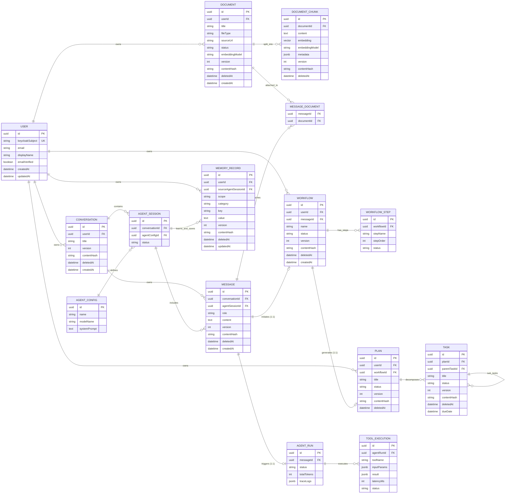

# 🏛️ AIOS — Master Entity-Relationship Diagram (ERD)

> **Kiến trúc:** Modular Monolith | Message-Centric Design | Multi-tenant Ownership | E2EE Sync-Ready  
> **Cơ sở dữ liệu:** PGlite (WASM Embedded Postgres + bundled `pgvector`) trên Desktop (Zero-Daemon) | PostgreSQL 16 trên Docker Dev  
> **ORM:** Prisma v6 (`@prisma/adapter-pglite`)  
> **Quy mô:** 15 bảng dữ liệu phân rã trên 8 Business Bounded Contexts

---

## 1. Triết lý Thiết kế Cốt lõi (Architectural Principles)

1. **Chuẩn hóa Multi-user Ownership (`userId`) tại gốc:**
   * Mọi aggregate gốc (`conversations`, `documents`, `memory_records`, `workflows`, `plans`) bắt buộc sở hữu trường `userId` tham chiếu đến bảng `users` (được map từ Keycloak Subject).
   * Đảm bảo tính cô lập dữ liệu tuyệt đối (Data Isolation) giữa các người dùng; cấm truy cập chéo dữ liệu.
2. **Sẵn sàng cho E2EE Sync đa thiết bị (Sync-Ready Schema):**
   * Tất cả các bảng nghiệp vụ cốt lõi đều được trang bị:
     * `version INT @default(1)`: Kiểm soát phiên bản và phát hiện xung đột dữ liệu (Optimistic Concurrency).
     * `contentHash VARCHAR`: Hash SHA-256 để kiểm tra tính toàn vẹn khi đồng bộ qua Sync Envelope.
     * `deletedAt TIMESTAMP`: Soft-delete đóng vai trò **Tombstone** để đồng bộ trạng thái xóa sang các thiết bị khác.
   * `documents` và `document_chunks` có trường `embeddingModel` phục vụ cơ chế **Smart Vector Sync** (tiết kiệm chi phí re-embedding trên thiết bị mới).
3. **Lấy `Message` làm trung tâm điều phối (Message-Centric Design):**
   * Toàn bộ hành động tự trị của AI (Suy luận ReAct, Khởi tạo Workflow, Gọi Tool ngoại vi) đều bắt nguồn và có thể truy vết ngược (Full Traceability) về đúng 1 tin nhắn cụ thể của người dùng.
4. **Tách bạch 3 tầng Agent (Config → Session → Run):**
   * `agent_configs`: **Ai?** (Danh tính, System Prompt, Model LLM).
   * `agent_sessions`: **Khi nào?** (Phiên làm việc dài hạn chứa nhiều tin nhắn trao đổi).
   * `agent_runs`: **Làm gì?** (Vòng lặp ReAct `Reason → Act → Reflect` xử lý cho chính xác 1 Message).
5. **Truy vết nguồn gốc ký ức (Memory Traceability):**
   * `memory_records` gắn với `userId`, có ràng buộc duy nhất `@@unique([userId, key])`.
   * Liên kết mềm `sourceAgentSessionId` (Nullable) để trả lời: *"AI đã học được sở thích này từ phiên làm việc nào?"*.
6. **Knowledge RAG đa chiều (M:N Attachment):**
   * Bảng trung gian `message_documents` liên kết nhiều tài liệu với nhiều tin nhắn.
   * `document_chunks` tích hợp sẵn kiểu dữ liệu vector (`vector(768)`) của `pgvector`.
7. **Quy trình phân rã một chiều (Unidirectional Pipeline):**
   * `Message` $\xrightarrow{1:1}$ `Workflow` $\xrightarrow{1:N}$ `WorkflowStep`
   * `Workflow` $\xrightarrow{1:1}$ `Plan` $\xrightarrow{1:N}$ `Task` $\xrightarrow{1:N}$ `Task (Sub-tasks)`

---

## 2. Sơ đồ Thực thể Quan hệ (Master Mermaid ERD)



---

## 3. Từ điển Dữ liệu Chi tiết (Data Dictionary by Module)

### 3.1. Auth & Identity Projection (`users`)
| Bảng | Cột | Kiểu dữ liệu | Ràng buộc | Mô tả |
|---|---|---|---|---|
| **`users`** | `id` | `UUID` | PK, Default `gen_random_uuid()` | Định danh người dùng nội bộ |
| | `keycloakSubject` | `VARCHAR` | UNIQUE, Nullable | Subject ID (`sub`) từ Keycloak OIDC (null cho dev default user) |
| | `email` | `VARCHAR` | NOT NULL | Địa chỉ email người dùng |
| | `displayName` | `VARCHAR` | Nullable | Tên hiển thị |
| | `emailVerified` | `BOOLEAN` | Default `false` | Trạng thái xác thực email từ Keycloak |
| | `createdAt` / `updatedAt` | `TIMESTAMP` | Default `now()` | Thời gian tạo và cập nhật |

### 3.2. Chat Module (`conversations`, `messages`)
| Bảng | Cột | Kiểu dữ liệu | Ràng buộc | Mô tả |
|---|---|---|---|---|
| **`conversations`** | `id` | `UUID` | PK, Default `gen_random_uuid()` | Định danh cuộc hội thoại |
| | `userId` | `UUID` | FK $\rightarrow$ `users.id`, CASCADE | Chủ sở hữu cuộc hội thoại |
| | `title` | `VARCHAR` | Nullable | Tiêu đề cuộc hội thoại |
| | `version` | `INTEGER` | Default `1` | Phiên bản phục vụ E2EE Sync |
| | `contentHash` | `VARCHAR` | Nullable | SHA-256 hash nội dung |
| | `deletedAt` | `TIMESTAMP` | Nullable | Soft-delete / Tombstone |
| | `createdAt` / `updatedAt` | `TIMESTAMP` | Default `now()` | Thời gian tạo và cập nhật |
| **`messages`** | `id` | `UUID` | PK, Default `gen_random_uuid()` | Định danh tin nhắn |
| | `conversationId` | `UUID` | FK $\rightarrow$ `conversations.id`, CASCADE | Thuộc hội thoại nào |
| | `agentSessionId` | `UUID` | FK $\rightarrow$ `agent_sessions.id`, SET NULL | Thuộc phiên agent nào (Nullable) |
| | `role` | `VARCHAR` | `user` \| `assistant` \| `tool` \| `system` | Vai trò người gửi |
| | `content` | `TEXT` | NOT NULL | Nội dung tin nhắn |
| | `version` | `INTEGER` | Default `1` | Phiên bản phục vụ E2EE Sync |
| | `contentHash` | `VARCHAR` | Nullable | SHA-256 hash |
| | `deletedAt` | `TIMESTAMP` | Nullable | Tombstone |
| | `createdAt` | `TIMESTAMP` | Default `now()` | Thời gian tạo |

### 3.3. Knowledge Module (`documents`, `document_chunks`, `message_documents`)
| Bảng | Cột | Kiểu dữ liệu | Ràng buộc | Mô tả |
|---|---|---|---|---|
| **`documents`** | `id` | `UUID` | PK, Default `gen_random_uuid()` | Định danh tài liệu gốc |
| | `userId` | `UUID` | FK $\rightarrow$ `users.id`, CASCADE | Chủ sở hữu tài liệu |
| | `title` | `VARCHAR` | NOT NULL | Tên file hoặc tiêu đề |
| | `fileType` | `VARCHAR` | Nullable | Định dạng file (`pdf`, `md`, `docx`...) |
| | `sourceUrl` | `VARCHAR` | Nullable | Đường dẫn lưu trữ local |
| | `status` | `VARCHAR` | `pending` \| `processing` \| `indexed` \| `failed` | Tiến trình nạp RAG |
| | `embeddingModel` | `VARCHAR` | Nullable | Tên model nhúng (vd: `text-embedding-3-small`) |
| | `version` | `INTEGER` | Default `1` | Phiên bản phục vụ E2EE Sync |
| | `contentHash` | `VARCHAR` | Nullable | Hash nội dung |
| | `deletedAt` | `TIMESTAMP` | Nullable | Tombstone |
| | `createdAt` | `TIMESTAMP` | Default `now()` | Thời điểm upload |
| **`document_chunks`** | `id` | `UUID` | PK, Default `gen_random_uuid()` | Đoạn văn bản băm nhỏ |
| | `documentId` | `UUID` | FK $\rightarrow$ `documents.id`, CASCADE | Thuộc tài liệu nào |
| | `content` | `TEXT` | NOT NULL | Nội dung text của chunk |
| | `embedding` | `vector(768)` | Nullable | Vector nhúng qua extension `pgvector` |
| | `embeddingModel` | `VARCHAR` | Nullable | Model nhúng đã dùng sinh vector |
| | `metadata` | `JSONB` | Nullable | Offset, page number, heading |
| | `version` | `INTEGER` | Default `1` | Phiên bản Sync |
| | `deletedAt` | `TIMESTAMP` | Nullable | Tombstone |
| **`message_documents`** | `messageId` | `UUID` | PK, FK $\rightarrow$ `messages.id`, CASCADE | Tin nhắn đính kèm file |
| | `documentId` | `UUID` | PK, FK $\rightarrow$ `documents.id`, CASCADE | Tài liệu được đính kèm |

### 3.4. Memory Module (`memory_records`)
| Bảng | Cột | Kiểu dữ liệu | Ràng buộc | Mô tả |
|---|---|---|---|---|
| **`memory_records`** | `id` | `UUID` | PK, Default `gen_random_uuid()` | Định danh ký ức dài hạn |
| | `userId` | `UUID` | FK $\rightarrow$ `users.id`, CASCADE | Chủ sở hữu ký ức |
| | `sourceAgentSessionId` | `UUID` | Nullable, FK $\rightarrow$ `agent_sessions.id`, SET NULL | Session nguồn (Traceability) |
| | `scope` | `VARCHAR` | `global` \| `conversation` | Phạm vi ảnh hưởng |
| | `category` | `VARCHAR` | `profile` \| `preference` \| `fact` | Phân loại ký ức |
| | `key` | `VARCHAR` | NOT NULL | Tên khóa thuộc tính |
| | `value` | `TEXT` | NOT NULL | Giá trị thông tin |
| | `version` | `INTEGER` | Default `1` | Phiên bản Sync |
| | `contentHash` | `VARCHAR` | Nullable | Hash nội dung |
| | `deletedAt` | `TIMESTAMP` | Nullable | Tombstone |
| | `updatedAt` | `TIMESTAMP` | Auto update | Thời điểm cập nhật |
| | *Index* | `UNIQUE` | `@@unique([userId, key])` | Khóa duy nhất theo từng user |

### 3.5. Planner Module (`plans`, `tasks`)
| Bảng | Cột | Kiểu dữ liệu | Ràng buộc | Mô tả |
|---|---|---|---|---|
| **`plans`** | `id` | `UUID` | PK, Default `gen_random_uuid()` | Định danh kế hoạch |
| | `userId` | `UUID` | FK $\rightarrow$ `users.id`, CASCADE | Chủ sở hữu kế hoạch |
| | `workflowId` | `UUID` | UNIQUE, FK $\rightarrow$ `workflows.id`, CASCADE | Sinh ra từ quy trình nào (1:1) |
| | `title` | `VARCHAR` | NOT NULL | Tiêu đề kế hoạch |
| | `status` | `VARCHAR` | `active` \| `completed` | Trạng thái kế hoạch |
| | `version` | `INTEGER` | Default `1` | Phiên bản Sync |
| | `deletedAt` | `TIMESTAMP` | Nullable | Tombstone |
| | `createdAt` | `TIMESTAMP` | Default `now()` | Thời điểm tạo |
| **`tasks`** | `id` | `UUID` | PK, Default `gen_random_uuid()` | Định danh nhiệm vụ |
| | `planId` | `UUID` | FK $\rightarrow$ `plans.id`, CASCADE | Thuộc kế hoạch nào |
| | `parentTaskId` | `UUID` | Nullable, FK $\rightarrow$ `tasks.id`, CASCADE | Nhiệm vụ cha (Sub-tasks) |
| | `title` | `VARCHAR` | NOT NULL | Tiêu đề nhiệm vụ |
| | `status` | `VARCHAR` | `todo` \| `in_progress` \| `done` | Tiến độ |
| | `dueDate` | `TIMESTAMP` | Nullable | Hạn chót |
| | `version` | `INTEGER` | Default `1` | Phiên bản Sync |
| | `deletedAt` | `TIMESTAMP` | Nullable | Tombstone |

### 3.6. Workflow Module (`workflows`, `workflow_steps`)
| Bảng | Cột | Kiểu dữ liệu | Ràng buộc | Mô tả |
|---|---|---|---|---|
| **`workflows`** | `id` | `UUID` | PK, Default `gen_random_uuid()` | Định danh quy trình |
| | `userId` | `UUID` | FK $\rightarrow$ `users.id`, CASCADE | Chủ sở hữu quy trình |
| | `messageId` | `UUID` | UNIQUE, FK $\rightarrow$ `messages.id`, CASCADE | Tin nhắn khởi tạo (1:1) |
| | `name` | `VARCHAR` | NOT NULL | Tên quy trình |
| | `status` | `VARCHAR` | `running` \| `paused` \| `completed` \| `failed` | Trạng thái State Machine |
| | `version` | `INTEGER` | Default `1` | Phiên bản Sync |
| | `deletedAt` | `TIMESTAMP` | Nullable | Tombstone |
| **`workflow_steps`** | `id` | `UUID` | PK, Default `gen_random_uuid()` | Bước thực hiện trong DAG |
| | `workflowId` | `UUID` | FK $\rightarrow$ `workflows.id`, CASCADE | Thuộc quy trình nào |
| | `stepName` | `VARCHAR` | NOT NULL | Tên bước |
| | `stepOrder` | `INTEGER` | NOT NULL | Thứ tự thực hiện |
| | `status` | `VARCHAR` | `pending` \| `running` \| `done` \| `skipped` | Trạng thái bước |
| | `stepOutput` | `JSONB` | Nullable | Kết quả bước |

### 3.7. Agents & Tools Module (`agent_configs`, `agent_sessions`, `agent_runs`, `tool_executions`)
| Bảng | Cột | Kiểu dữ liệu | Ràng buộc | Mô tả |
|---|---|---|---|---|
| **`agent_configs`** | `id` | `UUID` | PK | Cấu hình Agent |
| | `name` / `modelName` / `systemPrompt` | `VARCHAR/TEXT` | NOT NULL | Thông tin persona |
| **`agent_sessions`** | `id` | `UUID` | PK | Phiên làm việc dài hạn |
| | `conversationId` | `UUID` | FK $\rightarrow$ `conversations.id`, CASCADE | Thuộc hội thoại nào |
| | `agentConfigId` | `UUID` | FK $\rightarrow$ `agent_configs.id`, RESTRICT | Cấu hình Agent sử dụng |
| | `status` | `VARCHAR` | `active` \| `closed` | Trạng thái phiên |
| **`agent_runs`** | `id` | `UUID` | PK | Lượt chạy ReAct (1:1 với Message) |
| | `messageId` | `UUID` | UNIQUE, FK $\rightarrow$ `messages.id`, CASCADE | Message kích hoạt |
| | `status` / `totalTokens` / `traceLogs` | | | Trạng thái, token và lịch sử trace |
| **`tool_executions`** | `id` | `UUID` | PK | Lần gọi công cụ |
| | `agentRunId` | `UUID` | FK $\rightarrow$ `agent_runs.id`, CASCADE | Thuộc lượt chạy nào |
| | `toolName` / `inputParams` / `result` / `latencyMs` | | | Tên tool, input/output và độ trễ |

---

## 4. Quy ước Toàn vẹn & Lọc Dữ liệu (Integrity & Query Rules)

1. **Bắt buộc lọc theo `userId` & `deletedAt: null`:**
   Mọi câu lệnh truy vấn qua Prisma Repository và vector query đều phải tự động kèm theo:
   ```typescript
   where: {
     userId: currentUser.id,
     deletedAt: null,
   }
   ```
2. **Cơ chế Soft-Delete (Tombstone Propagation):**
   Khi người dùng xóa bản ghi, hệ thống không `DELETE` vật lý ngay lập tức mà gán `deletedAt = new Date()` và tăng `version = version + 1`. Client Sync Engine sẽ truyền tombstone này lên Sync Server để các thiết bị khác xóa theo. Việc dọn dẹp vật lý (Hard-delete/Compaction) được thực hiện định kỳ sau retention period (ví dụ: 30 ngày).
3. **Bảo tồn Ký ức khi xóa Session:**
   Khi xóa `agent_sessions`, các `memory_records` được học từ session đó vẫn được giữ lại nguyên vẹn và trường `sourceAgentSessionId` chuyển về `NULL` (`onDelete: SetNull`).
