# Use Case Diagram — AIOS

> Mô tả những hành động mà người dùng có thể thực hiện trong hệ thống AIOS trên cả Web App và Desktop App.

---

## Actor

* **Primary Actor:** `User` (Người dùng sở hữu hệ thống trên Web Browser hoặc Desktop App).

---

## Use Case Diagram

```mermaid
flowchart TD
    User(["👤 User"])

    subgraph AIOS ["🖥️ AIOS System"]

        subgraph AuthSync ["🔐 Identity & Sync"]
            UC0["Sign in via Keycloak OIDC"]
            UC_PAIR["Pair Web Client with Companion"]
            UC_CLAIM["Claim Local Dev Data"]
            UC_SYNC["Sync Encrypted Vault (E2EE)"]
        end

        subgraph Chat ["💬 Chat Module"]
            UC1["Send Message"]
            UC2["Receive Streaming Response"]
            UC3["View Conversation History"]
        end

        subgraph Knowledge ["📚 Knowledge Module (RAG)"]
            UC4["Upload Document\n(PDF / MD / DOCX)"]
            UC5["Delete Document (Tombstone)"]
            UC6["Search Document (Semantic)"]
            UC7["Ask Question on Document"]
        end

        subgraph Memory ["🧠 Memory Module"]
            UC8["Save Memory"]
            UC9["Update Memory"]
            UC10["Delete Memory"]
            UC11["View Stored Memories"]
        end

        subgraph Planner ["📅 Planner Module"]
            UC12["Create Plan"]
            UC13["Update Plan & Tasks"]
            UC14["Complete Plan"]
            UC15["View Kanban / Roadmap"]
        end

        subgraph Tools ["🔧 Tool Module"]
            UC16["Use Search Tool"]
            UC17["Use Weather Tool"]
            UC18["Use Calculator Tool"]
            UC19["Use Filesystem Tool (Sandbox)"]
        end

        subgraph Workflow ["⚙️ Workflow Module"]
            UC20["Execute Workflow"]
            UC21["Resume Workflow"]
            UC22["Cancel Workflow"]
        end

        subgraph Agent ["🤖 Agent Module"]
            UC23["Configure Agent Persona"]
            UC24["Execute ReAct Agent"]
            UC25["Route to Specialized Agent"]
        end

    end

    %% User Connections
    User --> UC0
    User --> UC_PAIR
    User --> UC_SYNC
    User --> UC1
    User --> UC3
    User --> UC4
    User --> UC5
    User --> UC6
    User --> UC7
    User --> UC8
    User --> UC11
    User --> UC12
    User --> UC15
    User --> UC20
    User --> UC23

    %% Flow Extensions
    UC0 --> UC_CLAIM
    UC1 --> UC2
    UC7 --> UC6
    UC20 --> UC24
    UC24 --> UC25
    UC25 --> UC16
    UC25 --> UC17
    UC25 --> UC18
    UC25 --> UC19
```

---

## Mô tả Use Case theo nhóm

### Identity & Sync
| Use Case | Mô tả |
|---|---|
| Sign in via Keycloak OIDC | Đăng nhập an toàn bằng Google IdP hoặc Email thông qua Keycloak OIDC PKCE. |
| Pair Web Client with Companion | Xác thực kết nối giữa Web App và Local Companion thông qua mã pairing và Browser PNA. |
| Claim Local Dev Data | Nhập dữ liệu cũ đã tạo lúc offline/dev vào tài khoản Keycloak sau khi đăng nhập. |
| Sync Encrypted Vault (E2EE) | Đồng bộ dữ liệu mã hóa đa thiết bị bằng Vault Key/Recovery Key (AES-256-GCM). |

### Chat Module
| Use Case | Mô tả |
|---|---|
| Send Message | Người dùng gửi tin nhắn hoặc yêu cầu cho AI. |
| Receive Streaming Response | Nhận phản hồi dạng stream token qua Server-Sent Events (SSE). |
| View Conversation History | Xem lại lịch sử các phiên hội thoại trước đó. |

### Knowledge Module (RAG)
| Use Case | Mô tả |
|---|---|
| Upload Document | Tải lên tài liệu (PDF, MD, DOCX), kích hoạt pipeline trích xuất và sinh vector nhúng. |
| Delete Document | Xóa mềm tài liệu (tạo Tombstone cho E2EE Sync). |
| Search Document | Tìm kiếm tương đồng ngữ nghĩa trong kho tài liệu thông qua `pgvector`. |
| Ask Question on Document | Hỏi đáp dựa trên nội dung tài liệu với trích dẫn grounded rõ ràng. |

### Memory Module
| Use Case | Mô tả |
|---|---|
| Save / Update Memory | Lưu và cập nhật thông tin dài hạn theo cặp `(userId, key)` và danh mục. |
| Delete Memory | Xóa mềm ký ức (Tombstone). |
| View Stored Memories | Xem danh sách ký ức trên giao diện Memory Board. |

### Planner, Workflow & Agents
| Use Case | Mô tả |
|---|---|
| View Kanban / Roadmap | Quản lý kế hoạch công việc và lộ trình tiến độ. |
| Execute Workflow | Chạy quy trình tự động hóa nhiều bước có lưu vết trạng thái để Pause/Resume. |
| Execute ReAct Agent | Kích hoạt chu trình suy luận tự trị `Reason → Act → Reflect` có Policy Guard kiểm duyệt công cụ. |
