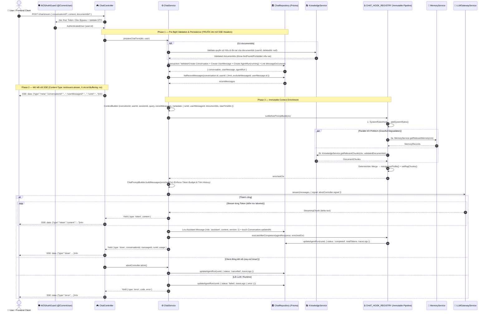

# 📋 Implementation Plan (v2): Task 2.3 — Chat Module Hoàn Chỉnh

## Goal Description
Hiện thực hoàn chỉnh **Chat Module (`apps/api/src/modules/chat`)** theo kiến trúc **Clean Architecture & Modular Monolith**, lấy **`Message` làm trung tâm điều phối (Message-Centric Design)**:
1. **Entrypoint hội thoại:** Cung cấp 2 API cốt lõi:
   - `POST /chat`: Phản hồi hội thoại đồng bộ (unary).
   - `POST /chat/stream`: Phản hồi Server-Sent Events (SSE Streaming token-by-token) cho giao diện thời gian thực, hỗ trợ hủy kết nối an toàn (`AbortController`).
2. **Quản lý danh tính & Sở hữu (Multi-tenant Ownership & Zero-Trust):**
   - Tiếp nhận danh tính từ `@CurrentUser()` (`AuthenticatedUser`), gắn `userId` vào `Conversation` (sở hữu `Message` được kế thừa trực tiếp qua `Conversation.userId`) cùng `AgentExecutionContext.userId`.
   - Mọi truy vấn ở `ChatRepository` đều **bắt buộc** lọc theo `userId` (hoặc join qua `conversation.userId`) và `deletedAt: null`.
   - Xác thực quyền sở hữu toàn bộ `documentIds` đính kèm qua `KnowledgeService`/`KnowledgeRepository` (`userId`, `deletedAt: null`) trước khi lưu `MessageDocument` và truy hồi RAG để ngăn chặn triệt để lỗ hổng IDOR.
3. **Làm giàu ngữ cảnh bất biến (Immutable Context Pipeline & Hooks):**
   - Khởi tạo `AgentExecutionContext` qua `ContextBuilder`.
   - Tách biệt việc lắp ráp hooks thông qua Factory Provider (`CHAT_HOOK_REGISTRY`) trong `ChatModule` (tuân thủ Open/Closed Principle).
   - Chuỗi Lifecycle Hooks `onBeforePromptBuild`:
     - `ChatSystemRulesHook`: Nạp System Rules & quy tắc trích dẫn nguồn (Grounded Citations).
     - `ChatContextEnrichmentHook` (Parallel I/O Prefetch + Deterministic Immutable Merge):
       - Chạy song song `Promise.allSettled([memoryFetch, knowledgeFetch])` để giảm 40-50% độ trễ TTFT.
       - Hợp nhất bất biến vào `ContextBuilder.from(ctx)`: `mergeUserProfile()` + `setRagChunks()`.
       - Graceful Degradation: Bắt lỗi an toàn, ghi nhận warning vào metadata, không làm crash luồng chat.
     - Nạp lịch sử hội thoại gần nhất (**bắt buộc loại trừ** `userMessage.id` vừa tạo để không gây bug trùng lặp tin nhắn) vào `ctx.prefetch.recentMessages`.
4. **Truy vết & Đo lường (Observability & AgentRun Lifecycle):**
   - Tạo bản ghi `AgentRun` (`status: 'running'`) trong cùng DB `$transaction` với `UserMessage`.
   - Quản lý trọn vẹn vòng đời `AgentRun` bằng `runId` (PK):
     - Thành công → `onAfterCompletion` cập nhật `status: 'completed'`, `latencyMs`, `totalTokens` (fallback qua `TokenCounterService` nếu stream không trả usage), `model`, `ragChunkCount`, `memoryKeys` vào `traceLogs`.
     - Lỗi hệ thống / LLM → `status: 'failed'` kèm `error` trong `traceLogs`.
     - Client ngắt kết nối SSE → `status: 'cancelled'`.
5. **Quản lý phiên hội thoại (Conversation & Message Management):**
   - Tự động tạo conversation (sinh tiêu đề mặc định an toàn từ nội dung câu hỏi đầu tiên) hoặc tiếp tục hội thoại theo `conversationId`.
   - Phân trang danh sách hội thoại, lịch sử tin nhắn, đổi tiêu đề và xóa mềm đồng bộ (`$transaction` soft-delete Conversation + Messages, tăng `version` phục vụ E2EE Sync).

---

## Architecture Diagram & Request Flow

---

## Technical Decisions & Guarantees

> [!IMPORTANT]
> **SSE Protocol & Pre-flight Error Handling:**
> - Lỗi xác thực (`401`), DTO không hợp lệ (`400`), không tìm thấy `conversationId` hoặc `documentIds` không thuộc sở hữu của user (`404`) được trả về **HTTP status code chuẩn REST** trước khi mở SSE stream.
> - Sau khi mở SSE (`text/event-stream; charset=utf-8`, `Cache-Control: no-cache, no-transform`, `Connection: keep-alive`, `X-Accel-Buffering: no`), các sự kiện gửi về gồm:
>   - `meta`: `{ type: 'meta', conversationId: string, userMessageId: string, runId: string }`
>   - `token`: `{ type: 'token', content: string }`
>   - `done`: `{ type: 'done', conversationId: string, messageId: string, runId: string, usage: TokenUsage }`
>   - `error`: `{ type: 'error', code: string, error: string }`

> [!NOTE]
> **Graceful Degradation & Observability Safety:**
> - Nếu `MemoryService` hoặc `KnowledgeService` (Vector Store / Embedding) gặp sự cố, hook bắt ngoại lệ, ghi nhận warning vào `traceLogs.warnings` và tiếp tục luồng chat bằng History + System Rules.
> - Nếu `ChatObservabilityHook` gặp lỗi khi cập nhật `AgentRun`, chỉ ghi log cảnh báo và **không** làm hỏng response đã trả cho người dùng.

---

## Proposed Changes

### Component 1: Shared Types & Core Hooks

#### [MODIFY] `packages/shared-types/src/chat/index.ts`
- Đồng bộ `IConversation` và `IMessage` với Prisma schema (`userId`, `version`, `contentHash`, `deletedAt`).
- Thêm SSE event union: `ChatStreamMetaEvent`, `ChatStreamTokenEvent`, `ChatStreamDoneEvent`, `ChatStreamErrorEvent`, `ChatStreamEvent`.
- Thêm `ChatResponseDto` (`{ conversationId, userMessageId, assistantMessage, runId, usage }`) và `PaginatedResponse<T>` (`{ items, total, limit, offset }`).

#### [MODIFY] `apps/api/src/core/hooks/hook-registry.ts`
- Gắn `@Injectable()` (tương thích 100% với `new HookRegistry()` trong unit test).

---

### Component 2: Chat Data Access Layer (Entities, DTOs & Repository)

#### [NEW] `apps/api/src/modules/chat/entities/chat-conversation.entity.ts`
- Domain entity cho `Conversation` với mapper `fromPrisma`.

#### [NEW] `apps/api/src/modules/chat/entities/chat-message.entity.ts`
- Domain entity cho `Message` với mapper `fromPrisma`, ánh xạ `messageDocuments` và `agentRuns`.

#### [NEW] `apps/api/src/modules/chat/dto/send-chat-message.dto.ts`
- `conversationId?: string`: `@IsOptional()`, `@IsUUID()`.
- `content: string`: `@IsString()`, `@IsNotEmpty()`, `@MaxLength(32000)` (chống DoS payload).
- `documentIds?: string[]`: `@IsOptional()`, `@IsArray()`, `@ArrayMaxSize(20)`, `@IsUUID(undefined, { each: true })`.
- Tuyệt đối **không** khai báo `userId`.

#### [NEW] `apps/api/src/modules/chat/dto/update-conversation.dto.ts`
- `title: string`: `@IsString()`, `@IsNotEmpty()`, `@MaxLength(200)`.

#### [NEW] `apps/api/src/modules/chat/dto/query-conversation.dto.ts`
- `limit?: number`: `@IsOptional()`, `@Type(() => Number)`, `@IsInt()`, `@Min(1)`, `@Max(100)` (default `50`).
- `offset?: number`: `@IsOptional()`, `@Type(() => Number)`, `@IsInt()`, `@Min(0)` (default `0`).

#### [MODIFY] `apps/api/src/modules/chat/chat.repository.ts`
- Nơi **duy nhất** trong `ChatModule` tương tác với `PrismaService`.
- **Quy tắc bắt buộc:** Mọi hàm truy vấn đều nhận `userId: string` (non-optional) và lọc `deletedAt: null`.
- **Conversation Methods:**
  - `findConversationById(id: string, userId: string)`
  - `listConversations(userId: string, options: { limit: number; offset: number })` → trả `{ items, total }`, sắp xếp `updatedAt: 'desc'`.
  - `updateConversation(id: string, userId: string, data: { title: string })` → kiểm tra ownership, cập nhật `title`, `version: { increment: 1 }`.
  - `softDeleteConversation(id: string, userId: string)` → dùng `prisma.$transaction`: soft-delete `Conversation` (`deletedAt: now`, `version + 1`) và soft-delete toàn bộ `Message` thuộc conversation đó.
- **Transactional Turn Initialization:**
  - `initializeChatTurn(params: { userId: string; conversationId?: string; defaultTitle: string; content: string; documentIds?: string[] })`:
    - Thực thi trong `prisma.$transaction`:
      1. Nếu có `conversationId`: kiểm tra tồn tại, `userId`, `deletedAt: null` (không có → trả `null` để service throw `NotFoundException`). Nếu không có: tạo `Conversation` mới với `userId`, `title: defaultTitle`, `version: 1`.
      2. Tạo `User Message` (`role: 'user'`, `content`, `version: 1`) và cập nhật `conversation.updatedAt`.
      3. Tạo `AgentRun` (`messageId: userMessage.id`, `status: 'running'`).
      4. Nếu có `documentIds` đã validate: tạo các bản ghi `MessageDocument` bằng `createMany({ skipDuplicates: true })`.
      5. Trả về `{ conversation, userMessage, agentRun }`.
- **Message Methods:**
  - `createAssistantMessage(data: { conversationId: string; userId: string; content: string; agentSessionId?: string })` → dùng `$transaction` tạo message và cập nhật `conversation.updatedAt`.
  - `listMessages(conversationId: string, userId: string, options: { limit: number; offset: number })` → xác thực ownership qua `conversation.userId`, trả `{ items, total }` theo thời gian tăng dần.
  - `listRecentMessages(conversationId: string, userId: string, options: { limit: number; excludeMessageId?: string })` → lấy `limit` tin nhắn mới nhất (`deletedAt: null`, `id: { not: excludeMessageId }`), sau đó đảo về thứ tự tăng dần theo `createdAt`.
- **AgentRun Methods (Observability):**
  - `updateAgentRun(runId: string, data: { status: 'running' | 'completed' | 'failed' | 'cancelled'; totalTokens?: number; traceLogs?: Prisma.InputJsonValue })`
  - `findAgentRunByMessageId(messageId: string, userId: string)` → lọc `message: { id: messageId, deletedAt: null, conversation: { userId, deletedAt: null } }`, trả bản ghi run mới nhất (`orderBy: { createdAt: 'desc' }`).

---

### Component 3: Chat Hooks & Scoped Hook Registry

#### [NEW] `apps/api/src/modules/chat/chat.tokens.ts`
- Định nghĩa DI token: `CHAT_HOOK_REGISTRY = Symbol('CHAT_HOOK_REGISTRY')` để cô lập pipeline của ChatModule khỏi các module khác.

#### [NEW] `apps/api/src/modules/chat/hooks/chat-system-rules.hook.ts`
- Cài đặt `onBeforePromptBuild(ctx)`: nạp System Rules mặc định của AIOS và hướng dẫn Grounded Citations.

#### [NEW] `apps/api/src/modules/chat/hooks/chat-context-enrichment.hook.ts`
- Cài đặt `onBeforePromptBuild(ctx)`:
  - Chạy song song `Promise.allSettled([memoryFetch, knowledgeFetch])`:
    - Memory: Gọi `memoryService.getRelevantMemory(ctx)` với `userId = ctx.userId`.
    - Knowledge: Đọc `validatedDocumentIds` từ `ctx.metadata`, gọi `knowledgeService.getRelevantChunks(ctx, { documentIds })`.
  - Hợp nhất bất biến vào `ContextBuilder.from(ctx)`:
    - Nếu Memory thành công: `mergeUserProfile(userProfile)`.
    - Nếu Knowledge thành công: `setRagChunks(chunks)`.
  - Bắt lỗi an toàn nếu có bên bị reject, ghi warning vào `metadata.warnings`.

#### [NEW] `apps/api/src/modules/chat/hooks/chat-observability.hook.ts`
- Cài đặt `onAfterCompletion(response, ctx)`:
  - Đọc `runId`, `startTimeMs`, `warnings` từ `ctx.metadata`.
  - Tính `latencyMs = Date.now() - startTimeMs`.
  - Cập nhật `AgentRun` qua `chatRepository.updateAgentRun(runId, { status: 'completed', totalTokens, traceLogs })`.
  - Bọc `try/catch` để lỗi observability không làm crash response người dùng.

---

### Component 4: Prompt Builder & Business Logic

#### [NEW] `apps/api/src/modules/chat/services/chat-prompt-builder.service.ts`
- Chuyển đổi `AgentExecutionContext` thành `LLMMessage[]`:
  - Phân bổ Token Budget hợp lý: giới hạn tối đa token cho phần RAG chunks và Memory Profile (tránh chiếm hết context window).
  - Ghép System Message = `System Rules` + `User Profile (Memory)` + `Knowledge Context (RAG Chunks)`.
  - Ghép `ctx.prefetch.recentMessages` (đã loại trừ userMessage hiện tại) theo thứ tự thời gian.
  - Đặt câu hỏi hiện tại (`ctx.query`) ở cuối cùng với `role: 'user'`.
  - Dùng `TokenCounterService.trimMessagesToFit` **chỉ cắt bớt các tin nhắn lịch sử cũ nhất ở giữa**, luôn bảo toàn System Message và User Message hiện tại.

#### [MODIFY] `apps/api/src/modules/chat/chat.service.ts`
- Inject `@Inject(CHAT_HOOK_REGISTRY) private readonly hookRegistry: HookRegistry` (không inject trực tiếp các concrete hooks).
- Tách hàm dùng chung `prepareChatTurn(dto, user)`:
  1. Nếu có `dto.documentIds?.length`: xác thực ownership & tồn tại qua `KnowledgeRepository` / `KnowledgeService` (`where: { id: { in: dto.documentIds }, userId: user.id, deletedAt: null }`). Nếu số lượng tìm được khác số lượng gửi lên → throw `NotFoundException('Một hoặc nhiều tài liệu đính kèm không tồn tại hoặc không thuộc quyền sở hữu.')`.
  2. Sinh `defaultTitle` an toàn từ `dto.content` (trim, gộp whitespace, cắt tối đa 80 ký tự).
  3. Gọi `chatRepository.initializeChatTurn(...)` (transaction).
  4. Gọi `chatRepository.listRecentMessages(conversation.id, user.id, { limit: HISTORY_LIMIT, excludeMessageId: userMessage.id })`.
  5. Trả về `PreparedChatTurn`.
- `sendMessage(dto, user)`:
  - Chạy `prepareChatTurn` → build `AgentExecutionContext` → `runBeforePromptBuild` → `ChatPromptBuilder` → `LLMGatewayService.generate`.
  - Thành công: lưu Assistant Message → gọi `executeAfterCompletion` → trả `ChatResponseDto`.
  - Lỗi: cập nhật `AgentRun` sang `'failed'` (trong `catch`) rồi rethrow lỗi.
- `executeStreamTurn(turn, signal)`:
  - Thực thi sau khi controller đã mở SSE headers và gửi event `meta`.
  - Gọi `LLMGatewayService.stream(messages, { signal })`, cộng dồn nội dung và yield `token`.
  - Nếu `signal.aborted`: cập nhật `AgentRun` sang `'cancelled'` và thoát sạch.
  - Khi stream xong: tính usage (ưu tiên usage từ LLM, fallback qua `TokenCounterService`), lưu Assistant Message, gọi `executeAfterCompletion`, yield `done`.
  - Nếu lỗi runtime/LLM: cập nhật `AgentRun` sang `'failed'`, yield `error`.
- CRUD & Observability methods: `listConversations`, `getConversation`, `listMessages`, `updateConversation`, `deleteConversation`, `getAgentRun` (tất cả đều truyền `user.id`).

---

### Component 5: Controller & Module Configuration

#### [MODIFY] `apps/api/src/modules/chat/chat.controller.ts`
- Bảo vệ toàn bộ controller bằng `@UseGuards(AIOSAuthGuard)` và dùng `@CurrentUser() user: AuthenticatedUser`.
- `POST /chat`: gọi `chatService.sendMessage(dto, user)`.
- `POST /chat/stream`:
  1. Gọi `const turn = await this.chatService.prepareChatTurn(dto, user)` **TRƯỚC** khi đụng tới `res` (lỗi 400/404 sẽ đi qua NestJS Exception Filter chuẩn).
  2. Thiết lập SSE headers (`Content-Type: text/event-stream; charset=utf-8`, `Cache-Control: no-cache, no-transform`, `Connection: keep-alive`, `X-Accel-Buffering: no`) và gọi `res.flushHeaders()`.
  3. Khởi tạo `AbortController`, lắng nghe `req.on('close', () => abortController.abort())`.
  4. Ghi event `meta` ngay lập tức.
  5. Lặp `for await (const event of this.chatService.executeStreamTurn(turn, abortController.signal))`, kiểm tra `!res.writableEnded` trước khi `res.write(...)`.
  6. Đóng kết nối trong `finally` (`if (!res.writableEnded) res.end()`).
- Các endpoints quản lý hội thoại & trace:
  - `GET /chat/conversations`
  - `GET /chat/conversations/:id`
  - `GET /chat/conversations/:id/messages`
  - `PATCH /chat/conversations/:id`
  - `DELETE /chat/conversations/:id`
  - `GET /chat/runs/:messageId`

#### [MODIFY] `apps/api/src/modules/chat/chat.module.ts`
- Import `MemoryModule`, `KnowledgeModule`, `InfrastructureModule`, `AuthModule`.
- Đăng ký `CHAT_HOOK_REGISTRY` bằng `useFactory` nhận các hook providers và register tập trung tại module level.
- Export `ChatService`, `ChatRepository`.

---

### Component 6: Documentation & Master Tasklist
- `[NEW]` `apps/api/src/modules/chat/docs/chat-module-business.md`
- `[NEW]` `apps/api/src/modules/chat/docs/chat-module-technical.md`
- `[NEW]` `docs/modules_rule/chat-module.md`
- `[MODIFY]` `docs/task_list.md`

---

## Verification Plan

### Automated Tests
1. **Repository Tests (`chat.repository.spec.ts`):**
   - Kiểm tra `initializeChatTurn` chạy trong `$transaction` (tạo mới conversation vs dùng conversation sẵn có, từ chối conversation của user khác / đã xóa mềm).
   - Kiểm tra `listRecentMessages` loại trừ đúng `excludeMessageId` và trả đúng thứ tự thời gian tăng dần.
   - Kiểm tra `softDeleteConversation` xóa mềm đồng thời conversation & messages trong `$transaction` và tăng `version`.
   - Kiểm tra `findAgentRunByMessageId(messageId, userId)` chặn truy cập chéo user (IDOR).
2. **Hook & Prompt Builder Tests (`chat-hooks.spec.ts`, `chat-prompt-builder.service.spec.ts`):**
   - Kiểm tra tính bất biến của `AgentExecutionContext` qua toàn bộ pipeline.
   - Kiểm tra Graceful Degradation khi Memory hoặc Knowledge throw error.
   - Kiểm tra `ChatPromptBuilderService`: không bị trùng User Message, luôn giữ nguyên System Message & User Message hiện tại khi cắt lịch sử theo token budget.
   - Kiểm tra `ChatObservabilityHook` cập nhật `AgentRun` bằng `runId` và không làm crash luồng nếu DB lỗi.
3. **Service Tests (`chat.service.spec.ts`):**
   - Kiểm tra `sendMessage` (unary): happy path + failure path (LLM lỗi → `AgentRun` chuyển sang `'failed'`).
   - Kiểm tra `prepareChatTurn`: reject khi `documentIds` không thuộc về `user.id` (chống IDOR).
   - Kiểm tra `executeStreamTurn`: yield `token` + `done`, fallback đếm token khi stream không có `usage`, và cập nhật `AgentRun` sang `'cancelled'` khi `AbortSignal` kích hoạt.
4. **Controller Tests (`chat.controller.spec.ts`):**
   - Kiểm tra `POST /chat/stream`: trả lỗi HTTP 404 **trước** khi set SSE headers nếu `conversationId` không hợp lệ; kiểm tra đủ SSE headers (`X-Accel-Buffering: no`), gửi event `meta` đầu tiên, và xử lý `req.on('close')`.
   - Kiểm tra toàn bộ CRUD endpoints và `GET /chat/runs/:messageId`.
5. **Full Test Suite & Build Verification:**
   - `npx pnpm --filter shared-types build`
   - `npx pnpm --filter api test`
   - `npx pnpm --filter api build`

### Manual Verification
1. Test `POST /chat` với Bearer Token / `AUTH_MODE=dev_bypass`: xác nhận trả lời đúng, DB lưu đủ `Conversation`, `Message` (user + assistant), `AgentRun` (`status: 'completed'`, `traceLogs` có `latencyMs`, `totalTokens`).
2. Test `POST /chat/stream` bằng `curl -N`: xác nhận nhận tuần tự `meta` → nhiều `token` → `done`; test bấm `Ctrl+C` giữa chừng và kiểm tra DB thấy `AgentRun.status = 'cancelled'`.
3. Test bảo mật: dùng token User B gọi `GET /chat/conversations/:idA`, `GET /chat/runs/:msgIdA`, và `POST /chat` kèm `documentIds` của User A → tất cả phải trả `404`.
