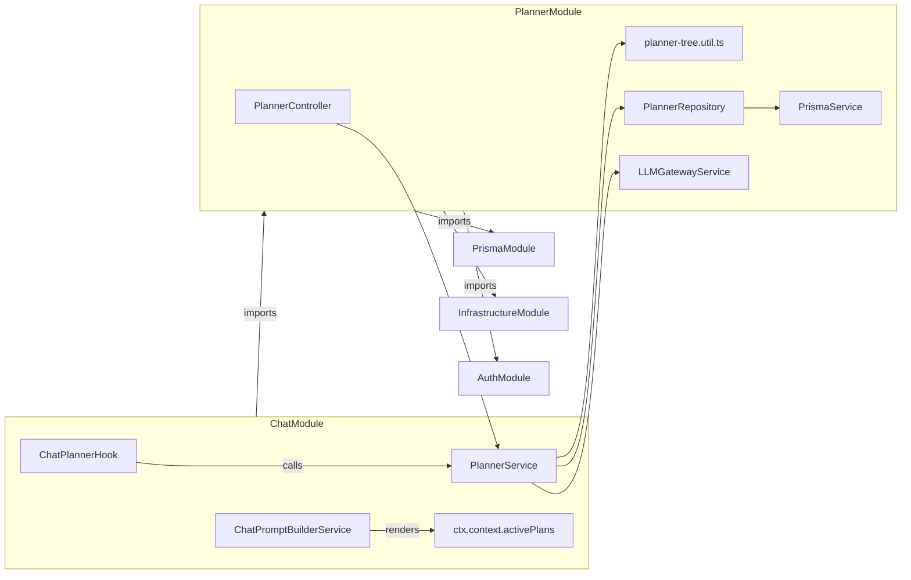
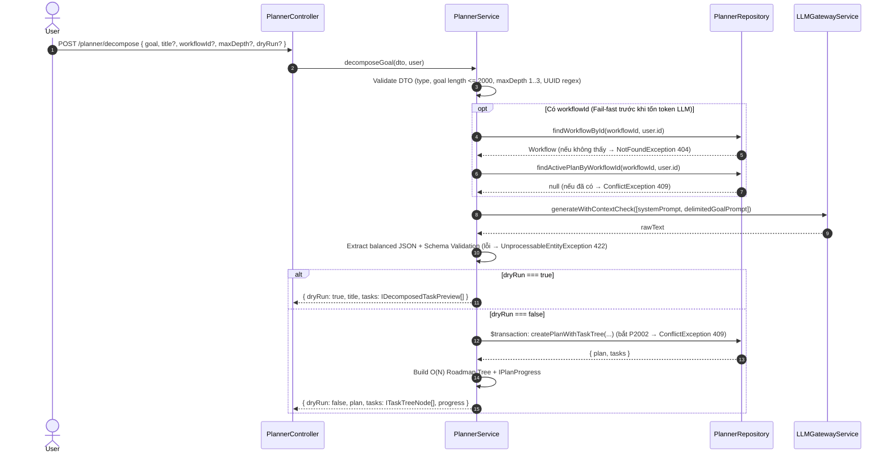

# 📋 Implementation Plan (v2.1): Task 3.1 — Planner Module (`modules/planner`)

## Goal Description

Hiện thực hoàn chỉnh **Task 3.1: Planner Module** (`apps/api/src/modules/planner` + `packages/shared-types/src/planner`) theo chuẩn **Clean Architecture, DDD Aggregate Locking, Multi-Tenant Zero-Trust và E2EE Sync-Readiness**:

1. **Quản lý Plans, Tasks & Hierarchical Roadmaps:** Full CRUD cho `Plan` (độc lập hoặc gắn `Workflow`), `Task` phân cấp đa tầng (`parentTaskId`), sắp xếp thứ tự anh em xác định (`order`), và tổng hợp tiến độ (`IPlanRoadmap` + `IPlanProgress`).
2. **Bảo mật & Toàn vẹn Dữ liệu (Multi-Tenant & Aggregate Integrity):**
   - Bắt buộc `@CurrentUser() user: AuthenticatedUser` ở Controller và `userId: string` (non-optional) ở mọi method của `PlannerRepository`.
   - Khóa mức Aggregate Root (`Plan` row lock `FOR UPDATE` **trước khi đọc dữ liệu mutable**) trong `prisma.$transaction` cho mọi thao tác biến đổi cấu trúc cây, triệt tiêu race condition tạo cycle, stale-read/lost-update, vượt quá `MAX_TASK_DEPTH`, hoặc tạo task vào plan đã archive/xóa.
   - Tombstone soft-delete đệ quy (Plan → Tasks; Task → toàn bộ Subtree), tăng `version` và giữ nguyên `contentHash` chuẩn hóa (vì `contentHash` chỉ hash business content fields).
3. **AI Goal Decomposition (`POST /planner/decompose`):**
   - Phân rã mục tiêu bằng `LLMGatewayService` (provider-agnostic, có fallback API key từ `.env`), chống prompt injection, parse JSON phòng thủ, hỗ trợ `dryRun` preview (type phân tách rõ) và lưu nguyên tử trong `$transaction`.
4. **Tích hợp Runtime vào `AgentExecutionContext` & Chat Pipeline:**
   - Bổ sung `PlannerService.getActivePlansContext(userId)` & `enrichContext(ctx)` (immutable qua `ContextBuilder.from(ctx)`).
   - Kết nối thật vào luồng chat thông qua `ChatPlannerHook` (trong `ChatModule`) và render có giới hạn token budget trong `ChatPromptBuilderService`.

---

## Codebase Audit & Architectural Fixes Included in Task 3.1

> [!NOTE]
> Phần audit dưới đây đã được đối chiếu trực tiếp với `apps/api/prisma/schema.prisma`, các file migration SQL hiện có, `apps/api/src/main.ts`, `apps/api/src/core/context/agent-context.interface.ts`, `apps/api/src/core/context/context-builder.ts`, `apps/api/src/core/llm/llm-gateway.service.ts` và `apps/api/src/modules/chat/`.

| Hạng mục | Vấn đề gốc (Audit Codebase & Failure Points) | Giải pháp chuẩn trong Task 3.1 |
|---|---|---|
| **1. DB Schema — `Plan.workflowId` & Soft-Delete** | `Plan.workflowId` đang là `String @unique @db.Uuid`, chặn tạo Plan độc lập. Nếu giữ `@unique` toàn cục thì sau khi soft-delete Plan gắn `workflowId = X`, tạo lại Plan mới cho `X` sẽ crash `P2002`. | Đổi `Plan.workflowId` thành `String? @db.Uuid` (bỏ `@unique`, đổi `Workflow.plans Plan[]`), và tạo **PostgreSQL Partial Unique Index** với đúng tên cột camelCase (`"workflowId"`, `"deletedAt"`) **sau** `DROP INDEX "plans_workflowId_key"`: `WHERE "workflowId" IS NOT NULL AND "deletedAt" IS NULL`. Bắt `P2002` → `ConflictException (409)`. |
| **2. DB Schema — Migration Safety, Sync & Ordering** | `Plan` và `Task` thiếu `description`, `updatedAt`, `Task.order` và composite indexes. Thêm `updatedAt DateTime @updatedAt` không có `@default(now())` sẽ **fail migration** trên bảng đã có row cũ. | Thêm `description String?`, `updatedAt DateTime @default(now()) @updatedAt`, `Task.order Int @default(0)` và composite indexes. Khi `createTask` không truyền `order`, tự gán `maxSiblingOrder + 1` trong transaction. |
| **3. DB Logic — Tombstone Cascade & Canonical `contentHash`** | Soft-delete cha để lại con active mồ côi. Ngoài ra, tính `contentHash` trực tiếp từ PATCH payload làm sai hash, còn `updateMany` khi soft-delete không thể tính hash riêng từng row. | Quy ước sạch: `contentHash` **chỉ hash business content fields** (`Plan`: `title`, `description`, `status`, `workflowId`; `Task`: `title`, `description`, `status`, `order`, `dueDate`, `parentTaskId`), **không** gồm `deletedAt`/`version`/`updatedAt`. Khi `update`, merge state DB + patch rồi tính hash. Khi soft-delete đệ quy bằng `updateMany`, giữ nguyên `contentHash` + đặt `deletedAt = now` + `version: { increment: 1 }`. |
| **4. Graph Logic — Reparenting Subtree Depth & Lock Order (Stale Read)** | Chỉ check `depth(newParent) + 1 <= MAX_TASK_DEPTH` khiến node cháu vượt trần độ sâu. Đọc `task` trước khi lấy `FOR UPDATE` lock gây **stale read / lost update** khi chờ lock. | Acquire lock `FOR UPDATE OF p` **trước** bằng câu join `plans INNER JOIN tasks`, sau đó mới đọc `task` và `activeTasks`, verify `deletedAt === null`, check cycle, same-plan và công thức `depth(newParent) + 1 + maxSubtreeHeight(task) <= MAX_TASK_DEPTH`. |
| **5. Plan Lifecycle & Workflow Edge Cases** | 1) `POST /planner/plans` có `workflowId` chưa check `findWorkflowById` có thể bắn `P2003` (`500`).<br>2) Chặn sửa task trên plan `archived` dễ khóa nhầm thao tác un-archive plan. | 1) `POST /planner/plans` check `findWorkflowById(workflowId, user.id)` (`404`) + active conflict (`409`) giống `decomposeGoal`.<br>2) `PATCH /planner/plans/:id` **cho phép** chuyển `status` từ `'archived'` về `'active'` (un-archive), trong khi vẫn chặn sửa/tạo Task thuộc plan `archived`. |
| **6. Validation & Pipes (`main.ts` Verified)** | `apps/api/src/main.ts` **không bật** global `ValidationPipe` và `class-validator` không có trong `package.json`. `ParseUUIDPipe({ version: '4' })` từ chối UUIDv7 / seed UUID. | Giữ DTO thuần TS (nhất quán với `Memory`/`Knowledge`/`Chat`), validator chặt trong `PlannerService` (runtime `typeof`, max-length, integer range, ISO date, UUID regex, explicit field whitelisting), và dùng `new ParseUUIDPipe()`. |
| **7. Core — `LLMGatewayService` & Provider Leakage** | `LLMGatewayService` chỉ đọc `LLM_API_KEY` (bỏ qua `OPENAI_API_KEY` / `GEMINI_API_KEY`). `ILLMClient` spread `options` vào từng SDK nên `response_format` làm lỗi Gemini/Ollama. | Bổ sung fallback API key theo provider (`LLM_API_KEY \|\| OPENAI_API_KEY` / `GEMINI_API_KEY`). Không truyền provider-specific option từ `PlannerService`; dùng strict JSON prompt + balanced JSON extractor/validator. |
| **8. Chat Integration — Dead `activePlans`, `ContextBuilder` & TS Typing** | `ctx.context.activePlans` chưa có hook nạp và chưa render. `ContextBuilder.setActivePlans(plans)` spread `{ ...plans }` (Array bị biến thành `{ "0": ... }`). Ngoài ra, `interface` trong TS không tự thỏa mãn `Record<string, unknown>`. | Tạo `ChatPlannerHook` (Graceful Degradation) đăng ký vào `CHAT_HOOK_REGISTRY` (đã xác nhận `chat.service.spec.ts` / `chat-hooks.spec.ts` không assert cứng số lượng hook). Khai báo `IActivePlansSnapshot` dạng **`type` alias** (`{ plans: IActivePlanContext[]; totalActivePlans: number }`) để khớp `Record<string, unknown>` không cần `as any`, và render có Token Budget (~600 tokens) trong `ChatPromptBuilderService`. |
| **9. AI Decomposition & Tree Edge Cases** | Chưa tách type `dryRun` vs persisted; check `workflowId` sau LLM gây tốn token; lỗi LLM trả `400`; chia `0` ở `completionRate`; task active mất parent bị ẩn khỏi Roadmap. | Check `workflowId` **trước** khi gọi LLM; bọc goal trong `<user_goal>...</user_goal>`; lỗi LLM trả `UnprocessableEntityException (422)`; validate `dueDaysOffset` (`0..3650`); tách union `DecomposeGoalDryRunResult \| DecomposeGoalPersistedResult`; `totalTasks === 0 -> completionRate = 0`; Tree Builder `O(N)` hỗ trợ orphan recovery. |

*(Cross-cutting debt ngoài phạm vi Task 3.1 được ghi nhận nhưng không sửa lan sang module khác: `MemoryRepository` chưa tăng `version` và cho phép `userId?` optional; `AgentRunStatus` thiếu `'cancelled'`. Task 3.1 tuyệt đối không lặp lại các pattern này.)*

---

## Architecture & Dependency Graph


*(Đồ thị phụ thuộc hoàn toàn là DAG một chiều — không có Circular Dependency).*

---

## Request Flow — `POST /planner/decompose`



---

## Technical Decisions & Guarantees

> [!IMPORTANT]
> **1. Database Migration Order & Quoted CamelCase SQL Identifiers:**
> Toàn bộ bảng hiện tại (`plans`, `tasks`) trong PostgreSQL của AIOS dùng tên cột **camelCase** có dấu ngoặc kép (ví dụ `"workflowId"`, `"deletedAt"`, `"userId"`, `"updatedAt"`, `"parentTaskId"`, `"planId"`).
> - Trong file migration `--create-only`, phải kiểm tra `DROP INDEX "plans_workflowId_key";` nằm **trước** dòng chèn:
>   ```sql
>   CREATE UNIQUE INDEX "plans_workflowId_active_unique"
>   ON "plans"("workflowId")
>   WHERE "workflowId" IS NOT NULL AND "deletedAt" IS NULL;
>   ```
> - Lock mức Aggregate Root **trước khi đọc task** trong `updateTaskInPlan` & `softDeleteTaskCascade`:
>   ```sql
>   SELECT p."id", p."status", p."deletedAt"
>   FROM "plans" p
>   INNER JOIN "tasks" t ON t."planId" = p."id"
>   WHERE t."id" = $1::uuid AND p."userId" = $2::uuid
>   FOR UPDATE OF p;
>   ```
> - Cả Partial Unique Index và `SELECT ... FOR UPDATE OF p` đều tương thích với PostgreSQL 16 (Docker Dev) và PGlite WASM Postgres (Desktop Phase 8).

> [!IMPORTANT]
> **2. Pure DTO + Strict Service-Layer Validation (`main.ts` Confirmed):**
> `apps/api/src/main.ts` không bật `ValidationPipe` toàn cục và `class-validator` không được cài đặt. DTO giữ dạng pure TypeScript class; `PlannerService` thực hiện validation tường minh cho mọi input (kiểu dữ liệu, max-length, enum/status whitelist, ISO date, UUID regex, explicit field whitelisting) và ném `BadRequestException (400)` rõ ràng. Các route params dùng `new ParseUUIDPipe()` (chấp nhận mọi phiên bản UUID hợp lệ).

> [!NOTE]
> **3. Canonical `contentHash` & Progress Metrics:**
> - `contentHash` = `SHA-256` của canonical JSON chứa **chỉ các business content fields** **sau khi merge** state hiện tại + bản cập nhật (`Plan`: `title`, `description`, `status`, `workflowId`; `Task`: `title`, `description`, `status`, `order`, `dueDate`, `parentTaskId`) — không gồm `deletedAt`, `version`, `updatedAt`. Do đó PATCH 1 field cho hash chuẩn xác và `updateMany` khi soft-delete giữ nguyên đúng `contentHash`.
> - `IPlanProgress.completionRate`: phần trăm từ `0` đến `100`, làm tròn 2 chữ số thập phân (`totalTasks === 0 ? 0 : Math.round((done / totalTasks) * 10000) / 100`).

---

## Proposed Changes

### Component 1: Database Schema & Migration (`apps/api/prisma/`)

#### [MODIFY] `apps/api/prisma/schema.prisma`
- Model `Workflow`: đổi quan hệ `plan Plan?` thành `plans Plan[]`.
- Model `Plan`:
  - Đổi `workflowId` thành `String? @db.Uuid` (bỏ `@unique` toàn cục).
  - Đổi relation thành `workflow Workflow? @relation(fields: [workflowId], references: [id], onDelete: SetNull)`.
  - Thêm `description String?`.
  - Thêm `updatedAt DateTime @default(now()) @updatedAt` (an toàn cho bảng đã có dữ liệu).
  - Thêm `@@index([userId, deletedAt])` và `@@index([workflowId])`.
- Model `Task`:
  - Thêm `description String?`.
  - Thêm `order Int @default(0)`.
  - Thêm `updatedAt DateTime @default(now()) @updatedAt`.
  - Cập nhật comment status: `// "todo" | "in_progress" | "blocked" | "done"`.
  - Thêm `@@index([planId, deletedAt])` và `@@index([parentTaskId])`.
- Tạo migration `--create-only` (`make_plan_workflow_optional_and_add_planner_sync_fields`), kiểm tra thứ tự `DROP INDEX "plans_workflowId_key";` trước khi chèn `CREATE UNIQUE INDEX "plans_workflowId_active_unique" ...`, apply migration và chạy `prisma generate`.

---

### Component 2: Core & Chat Integration (`apps/api/src/core/` & `modules/chat/`)

#### [MODIFY] `apps/api/src/core/llm/llm-gateway.service.ts`
- Bổ sung fallback API key theo provider khi `LLM_API_KEY` chưa được set:
  - `LLMProvider.OPENAI` → `config.get('LLM_API_KEY') || config.get('OPENAI_API_KEY')`
  - `LLMProvider.GEMINI` → `config.get('LLM_API_KEY') || config.get('GEMINI_API_KEY')`

#### [NEW] `apps/api/src/modules/chat/hooks/chat-planner.hook.ts`
- Cài đặt `AIOSHookHandler.onBeforePromptBuild(ctx)`:
  - Gọi `plannerService.enrichContext(ctx)` để nạp active plans & tasks vào `ctx.context.activePlans`.
  - Bọc `try/catch` (Graceful Degradation): nếu lỗi DB, ghi log cảnh báo và gắn vào `metadata.warnings` (giữ nguyên luồng chat không crash).

#### [MODIFY] `apps/api/src/modules/chat/chat.module.ts`
- Import `PlannerModule`, cung cấp `ChatPlannerHook` và đăng ký vào `CHAT_HOOK_REGISTRY`.
- *(Đã kiểm tra `chat.service.spec.ts` & `chat-hooks.spec.ts`: đều mock/khởi tạo độc lập, không bị gãy khi thêm hook mới vào `ChatModule`.)*

#### [MODIFY] `apps/api/src/modules/chat/services/chat-prompt-builder.service.ts`
- Render `ctx.context.activePlans` (`IActivePlansSnapshot`) thành section `## Active Plans & Tasks` trong System Prompt khi có dữ liệu.
- Áp dụng **Token Budget** riêng cho phần `activePlans` (tối đa ~600 tokens, ưu tiên các plan mới cập nhật và task ở trạng thái `in_progress` / `blocked` / `todo`).

---

### Component 3: Shared Contracts (`packages/shared-types/`)

#### [MODIFY] `packages/shared-types/src/enums/index.ts`
- Thêm `PlanStatus`: `ACTIVE = 'active'`, `COMPLETED = 'completed'`, `ARCHIVED = 'archived'`.
- Giữ `TaskStatus`: `TODO = 'todo'`, `IN_PROGRESS = 'in_progress'`, `BLOCKED = 'blocked'`, `DONE = 'done'`.

#### [MODIFY] `packages/shared-types/src/planner/index.ts`
- Export đầy đủ contracts:
  - `PlanStatus`, `TaskStatus`
  - `IPlan`, `ITask`, `ITaskTreeNode` (`ITask & { subTasks: ITaskTreeNode[] }`)
  - `IPlanProgress` (`{ totalTasks, todo, inProgress, blocked, done, completionRate }` — `completionRate` từ `0..100`)
  - `IPlanRoadmap` (`{ plan: IPlan; progress: IPlanProgress; tasks: ITaskTreeNode[] }`)
  - `IActivePlanTaskSummary`, `IActivePlanContext`, và **`type IActivePlansSnapshot = { plans: IActivePlanContext[]; totalActivePlans: number }`** (dùng `type` alias để thỏa mãn `Record<string, unknown>` của `AgentExecutionContext.context.activePlans` mà không cần `as any`).
  - Payloads: `CreatePlanPayload`, `UpdatePlanPayload`, `QueryPlanFilter`, `CreateTaskPayload`, `UpdateTaskPayload`, `DecomposeGoalPayload`
  - Discriminated Union cho kết quả Decompose:
    - `IDecomposedTaskPreview`: `{ title: string; description: string | null; dueDate: string | null; order: number; subTasks: IDecomposedTaskPreview[] }`
    - `DecomposeGoalDryRunResult`: `{ dryRun: true; title: string; tasks: IDecomposedTaskPreview[] }`
    - `DecomposeGoalPersistedResult`: `{ dryRun: false; plan: IPlan; progress: IPlanProgress; tasks: ITaskTreeNode[] }`
    - `DecomposeGoalResult = DecomposeGoalDryRunResult | DecomposeGoalPersistedResult`

#### [MODIFY] `packages/shared-types/src/index.ts`
- Re-export `export * from './planner';`.

---

### Component 4: Planner Backend Module (`apps/api/src/modules/planner/`)

#### [DELETE] Legacy scaffold files
- `apps/api/src/modules/planner/dto/create-planner.dto.ts`
- `apps/api/src/modules/planner/dto/update-planner.dto.ts`
- `apps/api/src/modules/planner/entities/planner.entity.ts`

#### [NEW] DTOs (`apps/api/src/modules/planner/dto/`)
- `create-plan.dto.ts` (`title!`, `description?`, `workflowId?`, `status?`)
- `update-plan.dto.ts` (`title?`, `description?`, `status?`)
- `query-plan.dto.ts` (`status?`, `search?`, `limit?`, `offset?`)
- `create-task.dto.ts` (`title!`, `description?`, `parentTaskId?`, `status?`, `order?`, `dueDate?`)
- `update-task.dto.ts` (`title?`, `description?`, `parentTaskId?`, `status?`, `order?`, `dueDate?`)
- `decompose-goal.dto.ts` (`goal!`, `title?`, `workflowId?`, `maxDepth?`, `dryRun?`)

#### [NEW] Entities & Domain Utilities (`apps/api/src/modules/planner/`)
- `entities/plan.entity.ts`: `PlanEntity implements IPlan` + `fromPrisma`.
- `entities/task.entity.ts`: `TaskEntity implements ITask` + `fromPrisma`.
- `utils/planner-tree.util.ts` (Pure functions):
  - `buildTaskTree(tasks)`: `O(N)` single-pass map builder, sort theo `(order ASC, createdAt ASC)`, hỗ trợ **orphan recovery** (đẩy task mất parent lên root + trả `orphanIds` để log cảnh báo).
  - `computePlanProgress(tasks)`: tính `IPlanProgress` (`totalTasks === 0 -> completionRate = 0`).
  - `validateReparenting(tasks, taskId, newParentId, maxDepth)`: kiểm tra self-parent, cycle (ancestor walk kèm `Set`), và **`depth(newParent) + 1 + maxSubtreeHeight(task) <= maxDepth`**.
  - `collectDescendantIds(tasks, rootTaskId)`: BFS/DFS lặp với `visited` Set.
  - `computePlanContentHash(data)` & `computeTaskContentHash(data)`: canonical SHA-256 deterministic hash trên business fields đã merge.
  - `extractAndValidateDecompositionJson(rawText, maxDepth, maxTasks)`: tách balanced JSON object an toàn, validate schema đệ quy, giới hạn `maxDepth <= 3`, `maxTasks <= 50`, chuẩn hóa `dueDaysOffset` (`0..3650`).

#### [MODIFY] `apps/api/src/modules/planner/planner.repository.ts`
Nơi **duy nhất** truy cập `PrismaService`. Bắt buộc `userId: string` (non-optional) và `deletedAt: null` trên mọi truy vấn:
- **Helpers khóa mức Aggregate Root (Lock-before-read):**
  - `lockPlanForUpdate(tx, planId, userId)`: `SELECT "id", "status", "deletedAt" FROM "plans" WHERE "id" = $1::uuid AND "userId" = $2::uuid FOR UPDATE`.
  - `lockPlanByTaskIdForUpdate(tx, taskId, userId)`: `SELECT p."id", p."status", p."deletedAt" FROM "plans" p INNER JOIN "tasks" t ON t."planId" = p."id" WHERE t."id" = $1::uuid AND p."userId" = $2::uuid FOR UPDATE OF p`.
- **Plans:**
  - `createPlan(userId, data)` (bắt `P2002` trên `workflowId` → `ConflictException`, `P2003` nếu FK race → `NotFoundException`).
  - `findPlanById(id, userId)`
  - `findActivePlanByWorkflowId(workflowId, userId)`
  - `findWorkflowById(workflowId, userId)` (`userId`, `deletedAt: null`).
  - `listPlans(userId, { status?, search?, limit, offset })` → `{ items, total }` (search insensitive trên `title` & `description`, order `updatedAt: 'desc'`).
  - `listActivePlansWithTasks(userId, { maxPlans, maxTasksPerPlan })` (chỉ lấy `Plan.status = 'active'`, `deletedAt: null`, task chưa `done`).
  - `updatePlan(id, userId, patch)` → `$transaction` + `lockPlanForUpdate`: đọc bản ghi sau lock, cho phép un-archive (`archived -> active`), merge business fields để tính `contentHash`, tăng `version: { increment: 1 }`.
  - `softDeletePlan(id, userId)` → `$transaction` + `lockPlanForUpdate`: soft-delete `Plan` và toàn bộ active `Task` con (`updateMany` giữ nguyên `contentHash`, set `deletedAt = now`, tăng `version: { increment: 1 }`).
- **Tasks (Aggregate-Locked Transactions):**
  - `createTaskInPlan(userId, planId, data)` → `$transaction` + `lockPlanForUpdate`:
    - Verify plan tồn tại (`deletedAt === null`) và `status !== 'archived'`.
    - Nếu có `parentTaskId`: load active tasks của plan sau lock, verify `parentTaskId` tồn tại trong cùng `planId` và `depth(parent) + 1 <= MAX_TASK_DEPTH`.
    - Nếu `order === undefined`: tính `maxSiblingOrder + 1` cho anh em cùng `(planId, parentTaskId)`.
    - Tính canonical `contentHash` và insert.
  - `findTaskById(taskId, userId)` (filter `plan: { userId, deletedAt: null }`).
  - `listTasksByPlan(planId, userId)` (`order asc, createdAt asc`).
  - `updateTaskInPlan(userId, taskId, patch)` → `$transaction`:
    - Gọi `lockPlanByTaskIdForUpdate(tx, taskId, userId)` **TRƯỚC** khi đọc task.
    - Verify plan không bị `deleted`/`archived`, rồi đọc `task` (verify `deletedAt === null`).
    - Nếu `parentTaskId` thay đổi: load active tasks của plan, gọi `validateReparenting(...)` (`same-plan`, `cycle`, `depth + subtreeHeight <= MAX_TASK_DEPTH`).
    - Merge toàn bộ business fields hiện tại + patch → tính `contentHash`, tăng `version: { increment: 1 }`.
  - `softDeleteTaskCascade(userId, taskId)` → `$transaction`:
    - Gọi `lockPlanByTaskIdForUpdate(tx, taskId, userId)` **TRƯỚC** khi đọc task.
    - Verify plan active, đọc `task` (verify `deletedAt === null`), load active tasks của plan → `collectDescendantIds` → `updateMany` soft-delete toàn bộ subtree (`deletedAt = now`, `version: { increment: 1 }`, giữ nguyên `contentHash`). Trả `{ deletedId, deletedCount }`.
- **Transactional AI Tree Persist:**
  - `createPlanWithTaskTree(userId, params)` → `$transaction`: tạo `Plan` (bắt `P2002` → `ConflictException`), duyệt tạo các `Task` giữ đúng `parentTaskId`, `order`, `contentHash`, `version: 1`.

#### [MODIFY] `apps/api/src/modules/planner/planner.service.ts`
- Validation chặt chẽ (runtime type checks, max lengths: `title <= 200`, `description <= 5000`, `goal <= 2000`, `search <= 200`; `PlanStatus` & `TaskStatus` whitelist; valid ISO `dueDate`; non-negative integer `order`; UUID regex cho `workflowId` & `parentTaskId`; explicit field whitelisting).
- `createPlan(dto, user)`: nếu có `workflowId`, kiểm tra `findWorkflowById(workflowId, user.id)` (`404` nếu không tồn tại/không thuộc user) và `findActivePlanByWorkflowId(workflowId, user.id)` (`409` nếu đã có active plan).
- `updatePlan(id, dto, user)`: cho phép chuyển `status` từ `'archived'` về `'active'` (un-archive) hoặc sang `'completed'`/`'archived'`.
- `getRoadmap(planId, user)`: `O(N)` tree builder + `computePlanProgress`.
- `decomposeGoal(dto, user)`:
  - Fail-fast kiểm tra `workflowId` ownership & active conflict **trước** khi gọi LLM.
  - Build prompt chống prompt injection (`<user_goal>...</user_goal>`) + gọi `llmGateway.generateWithContextCheck(messages)`.
  - Parse & validate JSON → lỗi LLM/JSON hỏng throw `UnprocessableEntityException (422)`.
  - `dryRun: true` → trả `DecomposeGoalDryRunResult`; `dryRun: false` → `createPlanWithTaskTree` và trả `DecomposeGoalPersistedResult`.
- `getActivePlansContext(userId)` & `enrichContext(ctx)`:
  - Trả về `IActivePlansSnapshot` (tối đa 5 active plans, mỗi plan tối đa 10 task chưa `done`) và gắn vào `ContextBuilder.from(ctx).setActivePlans(...)` đảm bảo bất biến (`Object.isFrozen`).

#### [MODIFY] `apps/api/src/modules/planner/planner.controller.ts`
- Bảo vệ bởi `AIOSAuthGuard`, bắt buộc `@CurrentUser() user: AuthenticatedUser`, dùng `new ParseUUIDPipe()` trên mọi UUID path param.
- Đặt static routes trước parameterized routes:
  - `POST /planner/decompose`
  - `POST /planner/plans`
  - `GET /planner/plans`
  - `GET /planner/plans/:id/roadmap`
  - `GET /planner/plans/:id`
  - `PATCH /planner/plans/:id`
  - `DELETE /planner/plans/:id`
  - `POST /planner/plans/:planId/tasks`
  - `GET /planner/plans/:planId/tasks`
  - `PATCH /planner/tasks/:taskId`
  - `DELETE /planner/tasks/:taskId`

#### [MODIFY] `apps/api/src/modules/planner/planner.module.ts`
- Import `PrismaModule`, `InfrastructureModule`, `AuthModule`.
- Providers: `PlannerRepository`, `PlannerService`.
- Exports: `PlannerService`, `PlannerRepository`.

---

### Component 5: Documentation & Automated Tests

#### [NEW / MODIFY] Documentation
- `apps/api/src/modules/planner/docs/planner-module-business.md`
- `apps/api/src/modules/planner/docs/planner-module-technical.md`
- `docs/modules_rule/planner-module.md`
- Cập nhật `docs/task_list.md` sau khi verification pass.

#### [NEW / MODIFY] Unit Tests
1. `apps/api/src/modules/planner/utils/planner-tree.util.spec.ts`
2. `apps/api/src/modules/planner/planner.repository.spec.ts` (cover lock-before-read `lockPlanByTaskIdForUpdate`, `contentHash` preserved on soft-delete `updateMany`, merge-before-hash on `update`, `order` auto-increment, `P2002` → `ConflictException`)
3. `apps/api/src/modules/planner/planner.service.spec.ts` (cover `workflowId` validation on `createPlan`, un-archive `archived -> active`, cycle/subtree-depth guards, `decomposeGoal` fail-fast + 422 + `dryRun`, `enrichContext` immutability)
4. `apps/api/src/modules/planner/planner.controller.spec.ts`
5. `apps/api/src/modules/chat/hooks/chat-hooks.spec.ts` (test `ChatPlannerHook` & Graceful Degradation)
6. `apps/api/src/modules/chat/services/chat-prompt-builder.service.spec.ts` (test render `activePlans` & token budget)
7. `apps/api/src/app.module.spec.ts` (test DI graph `ChatModule -> PlannerModule` không circular dependency)

---

## Verification Plan

### Automated Verification
```bash
pnpm --filter @aios/shared-types build
pnpm --filter api exec prisma generate
pnpm --filter api lint
pnpm --filter api test
pnpm --filter api build
pnpm --filter web lint
pnpm --filter web build
```

### Manual Verification (PostgreSQL)
1. Khởi động Postgres (`cd docker && docker compose up -d`) và chạy `pnpm --filter api exec prisma migrate dev` — xác nhận `DROP INDEX "plans_workflowId_key"` chạy trước và Partial Unique Index `"plans_workflowId_active_unique"` được tạo thành công.
2. Kiểm tra vòng đời `workflowId`: `POST /planner/plans` với `workflowId` lạ (`404 Not Found`) → tạo Plan A gắn `workflowId = X` → tạo Plan B gắn `workflowId = X` (`409 Conflict`) → soft-delete Plan A (`DELETE /planner/plans/:idA`) → tạo lại Plan C gắn `workflowId = X` (`201 Created`).
3. Kiểm tra vòng đời archive: chuyển Plan sang `archived` → thử tạo/sửa task (`400 Bad Request`) → `PATCH /planner/plans/:id` chuyển lại `active` (thành công `200 OK`).
4. Kiểm tra cây task: tạo phân cấp 3 tầng → reparent subtree làm tổng độ sâu vượt 5 (`400 Bad Request`) → reparent tạo cycle (`400 Bad Request`) → `GET /planner/plans/:id/roadmap` → xóa mềm node cha và kiểm tra DB xác nhận toàn bộ node con có `"deletedAt" IS NOT NULL` và `version` tăng.
5. Kiểm tra `POST /planner/decompose` ở cả `dryRun: true` và `dryRun: false`.
6. Gọi `POST /chat` khi đang có Active Plan → xác nhận AI nhận biết được Plan/Task hiện tại của người dùng trong ngữ cảnh trả lời.
