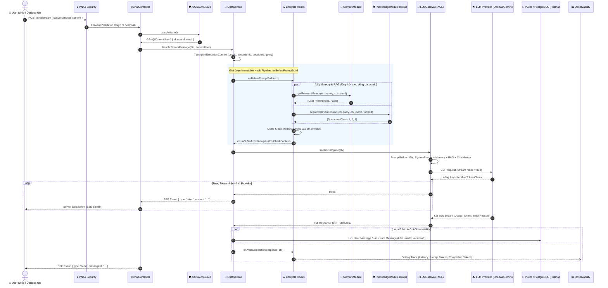
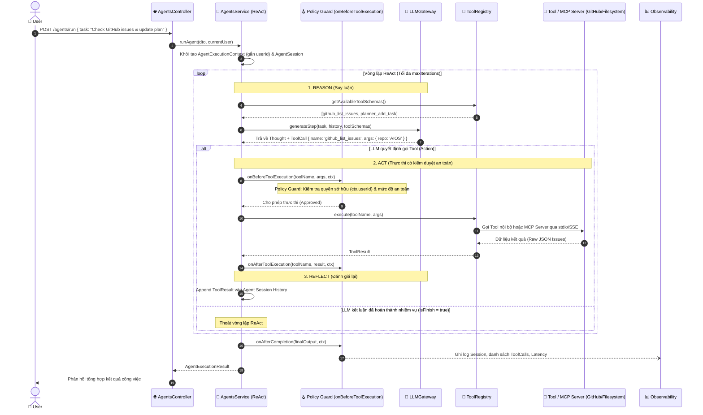
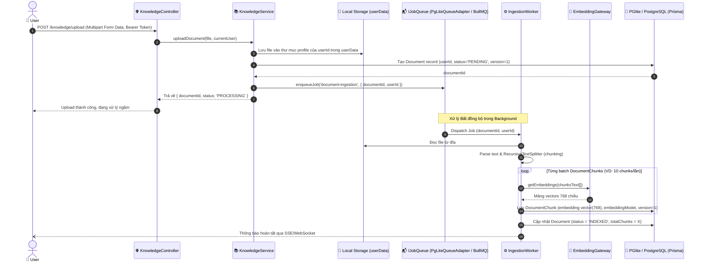
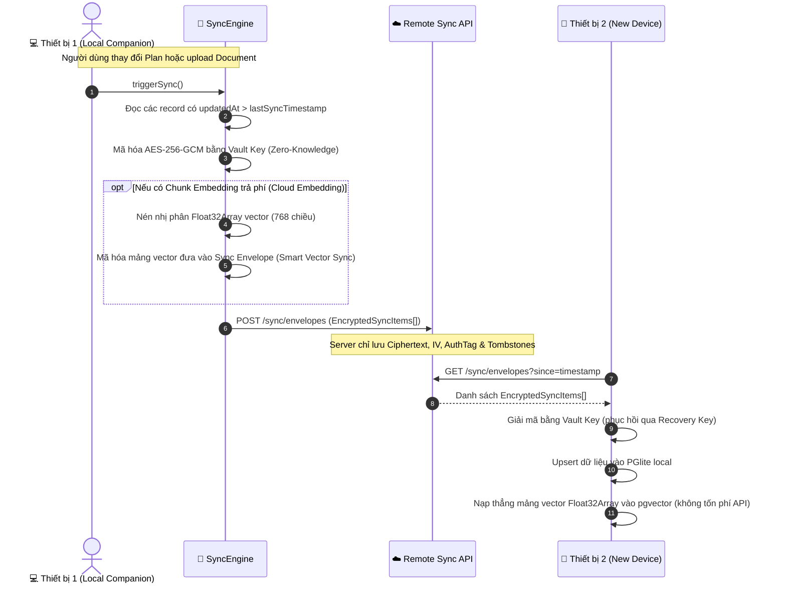

# AIOS Request Flow Specification

> **Tài liệu đặc tả chi tiết các luồng xử lý yêu cầu (Request Flow) trong hệ thống AIOS**  
> *Mô tả tường tận từ thời điểm Client gửi Request qua Ingress & Security Layer (PNA, AuthGuard), đi qua Lifecycle Hooks, Service Orchestrator, Core Gateway đến Hạ tầng lưu trữ (PGlite, Vector Store) và Streaming kết quả ngược lại.*

---

## 1. Tổng quan Các Loại Request trong AIOS

Hệ thống AIOS tiếp nhận và xử lý 6 luồng request chính:

1. **Flow 1: Conversational Chat Flow (Chat + Memory + RAG + Streaming):** Luồng trò chuyện trực tiếp với phản hồi streaming token qua SSE, có làm giàu context qua Immutable Hook Pipeline.
2. **Flow 2: Autonomous Agent Flow (ReAct Loop + Tool/MCP + Policy Guard):** Luồng thực thi nhiệm vụ phức tạp tự trị (`Reason` → `Act` → `Reflect`) có kiểm duyệt quyền sở hữu (`userId`) qua Policy Guard.
3. **Flow 3: Knowledge Ingestion & Indexing Flow:** Luồng tải lên tài liệu và xử lý trích xuất văn bản, chunking, sinh vector nhúng chạy ngầm qua `IJobQueue` (`PgLiteQueueAdapter` trên Desktop).
4. **Flow 4: Workflow Execution Flow (Multi-step DAG Pipeline):** Luồng điều phối các quy trình tự động hóa nhiều bước có lưu vết trạng thái để Pause/Resume.
5. **Flow 5: Background Memory Extraction Flow:** Luồng ngầm tự động phân tích hội thoại để trích xuất thói quen, sở thích của người dùng và lưu vào `memory_records` theo cặp `(userId, key)`.
6. **Flow 6: End-to-End Encrypted Sync Flow:** Luồng đóng gói dữ liệu local thành Sync Envelopes (AES-256-GCM), đồng bộ Tombstone và truyền mảng nhị phân vector nhúng (`Float32Array`).

---

## 2. Flow 1: Conversational Chat Flow (Chat + RAG + Memory)

Đây là luồng tương tác phổ biến nhất khi người dùng đặt câu hỏi trực tiếp trên Web hoặc Desktop Client.

### 2.1. Biểu đồ Sequence Diagram

---

## 3. Flow 2: Autonomous Agent Flow (ReAct Loop + Tool/MCP Execution)

Luồng kích hoạt khi người dùng giao một nhiệm vụ phức tạp đòi hỏi Agent phải tự suy luận và gọi công cụ bên ngoài.

### 3.1. Biểu đồ Sequence Diagram

---

## 4. Flow 3: Knowledge Ingestion & Indexing Flow

Xử lý khi người dùng tải lên tài liệu (PDF, Markdown, DOCX) để đưa vào RAG.

### 4.1. Biểu đồ Sequence Diagram

---

## 5. Flow 6: End-to-End Encrypted Sync Flow

Đồng bộ an toàn giữa thiết bị local và Cloud Sync Server.

---

## 6. Luồng Bảo Mật Browser PNA & Companion Pairing

Khi người dùng mở Web App trên trình duyệt (`https://app.aios.local` hoặc host remote) và muốn tương tác với Local Companion (`http://127.0.0.1:PORT`):

1. **Preflight PNA:** Trình duyệt gửi request `OPTIONS` kèm header `Access-Control-Request-Private-Network: true`. Local Companion phản hồi `Access-Control-Allow-Private-Network: true` kèm allowed origin.
2. **Pairing Challenge:** 
   * Người dùng nhấn "Pair with Desktop" trên Web App.
   * Desktop App hiển thị mã xác nhận Pairing Challenge (6 ký tự hoặc QR code) do người dùng chủ động yêu cầu.
   * Web App nhập mã challenge gửi xuống Local Companion.
   * Local Companion xác thực mã và cấp một `Scoped Companion Token` có thời hạn ngắn.
3. **Thực thi gọi API:** Mọi request tiếp theo từ Web App xuống Local Companion đều phải mang header `Authorization: Bearer <ScopedToken>`.
